
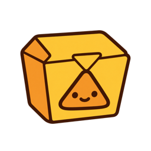

# Nacho Combo

One macOS menu bar app with six gadgets, each switched on or off on its own: a menu bar organizer, a system monitor,
window snapping, a file shelf, floating screen captures and focus dimming. No third-party apps, code or brands are used.

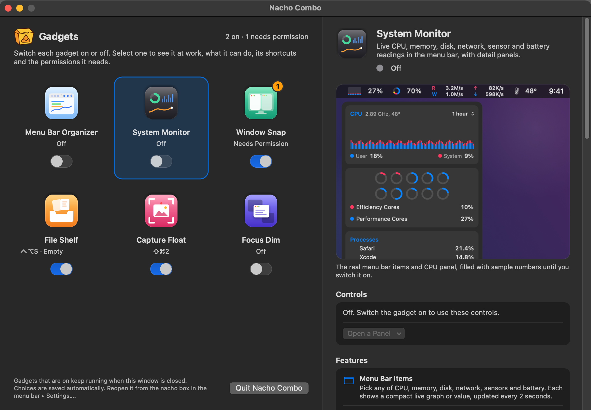

The app lives in the menu bar as its nacho box icon and has no Dock icon. Opening the app shows the **gadget gallery**
above: every gadget as a tile, and everything about the selected one on the right.

> The screenshots are rendered by the app itself (`scripts/screenshots.sh`). Where a gadget works on other apps'
> windows, the desktop around it is drawn; System Monitor pictures use sample numbers.

## Contents
- [Usage](#usage)
- [The gadget gallery](#the-gadget-gallery)
- [Gadgets](#gadgets): [Menu Bar Organizer](#menu-bar-organizer) · [System Monitor](#system-monitor) ·
  [Window Snap](#window-snap) · [File Shelf](#file-shelf) · [Capture Float](#capture-float) · [Focus Dim](#focus-dim)
- [Shortcuts](#shortcuts)
- [Quick panel](#quick-panel-menu-bar)
- [Install](#install-release) · [Build / test](#build--test) · [License](#license)

## Usage
1. Double-click `NachoCombo.app` (it is ad-hoc signed and not notarized, so the first launch may need right-click ▸ Open).
2. The gadget gallery opens. Switch on the gadgets you want; select a tile to read about it.
3. Gadgets that need a permission (Window Snap = Accessibility, Capture Float = Screen Recording) show the OS consent
   dialog **only at the moment you switch them on yourself**. If you deny it, the detail pane shows the reason and an
   open-settings button. Re-signing (rebuilding) can invalidate an earlier grant, so you may have to allow it again.
4. Closing the window keeps the gadgets that are on running. Right-clicking the nacho box in the menu bar ▸ `Settings…`,
   `Settings…` in its panel, or opening the app again brings it back. `Quit Nacho Combo` cleans up all monitoring,
   shortcuts and overlays.
5. Choices are saved automatically and restored on the next launch (no login item is registered).

## The gadget gallery

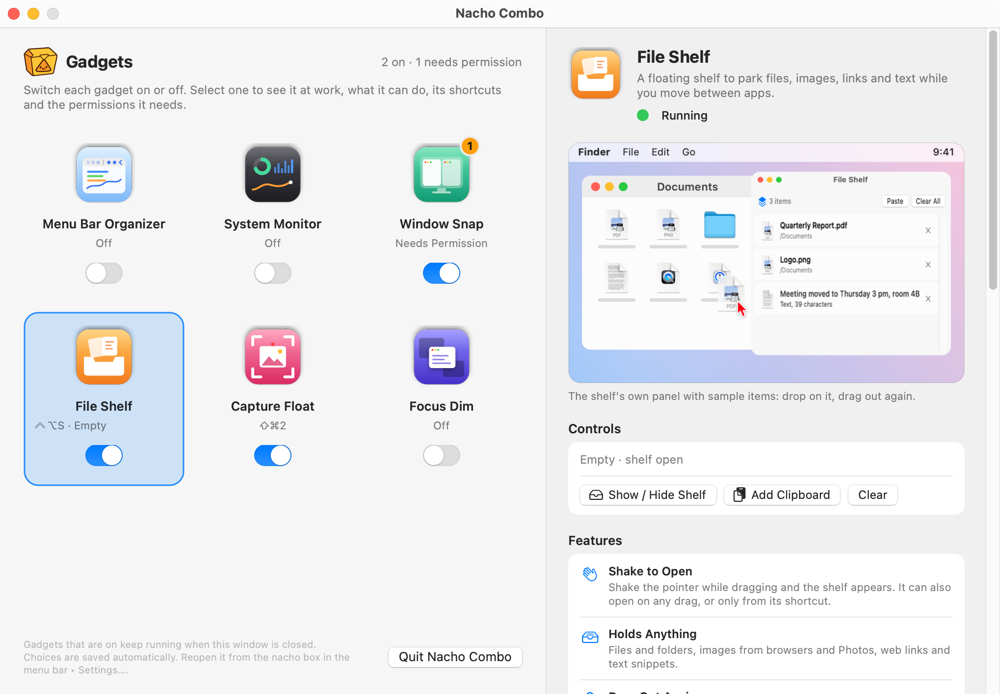

**Tiles (left).** Each tile shows the gadget's icon, its name, one live line and its own on / off switch. The line is
what matters most for that gadget: its main shortcut (`⌃⌥S · Empty`, `⇧⌘2`), live numbers (`CPU 18% · Memory 85%`),
or its state (`Off`, `Needs Permission`). An orange badge on the icon counts what needs attention: a missing
permission, an error, a shortcut another app already holds, or a System Monitor alert. The header sums it up
(`2 on · 1 needs permission`). Arrow keys move between tiles, Space flips the switch.

**Detail pane (right).** Selecting a tile shows, from top to bottom:

<table>
<tr>
<td width="50%" valign="top">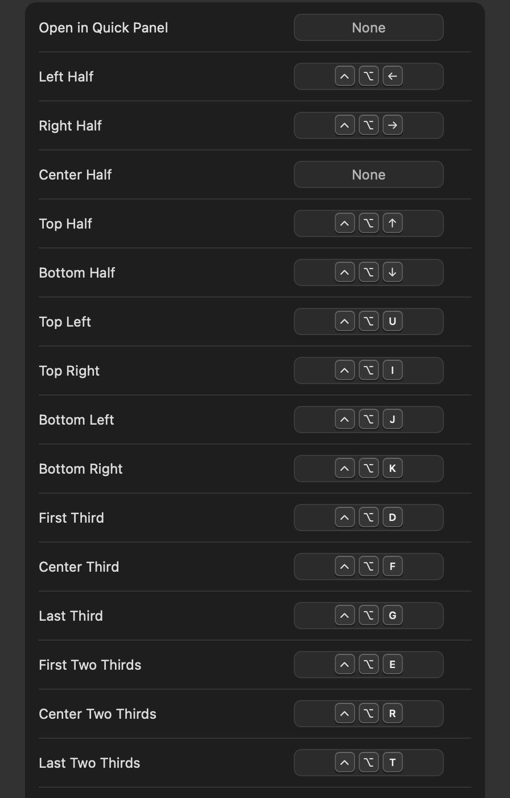</td>
<td width="50%" valign="top">

- **Header:** icon, name, one sentence and the real state (`Running`, `Off`, `Needs Permission`).
- **Notices:** what needs attention, in words, with the buttons that fix it (here: Open Accessibility Settings,
  Check Again).
- **Picture:** the gadget at work, drawn by the gadget's own views and following your settings (dim strength, gaps,
  shortcuts, the shelf's items, live System Monitor numbers once it runs).
- **Controls:** use it right away. Window Snap offers a grid of 18 layouts applied to the window of the app you used
  last; the other gadgets have their own buttons and sliders.
- **Features:** what it can do, one line each.

</td>
</tr>
</table>

<table>
<tr>
<td width="50%" valign="top">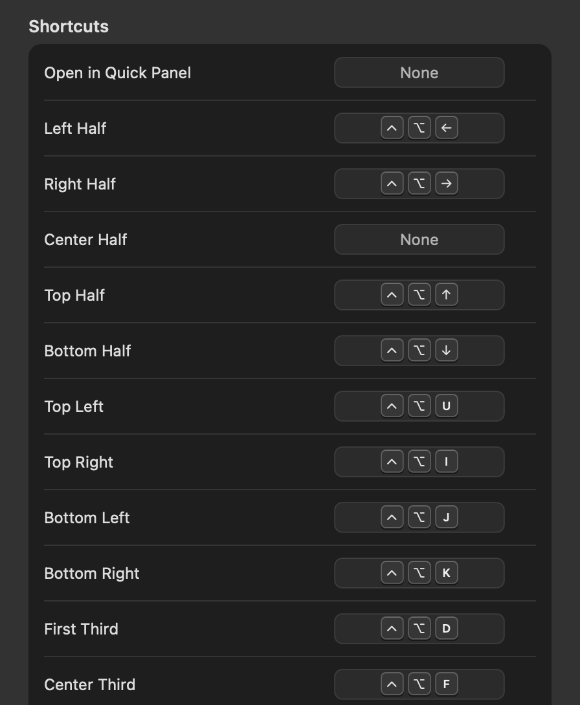</td>
<td width="50%" valign="top">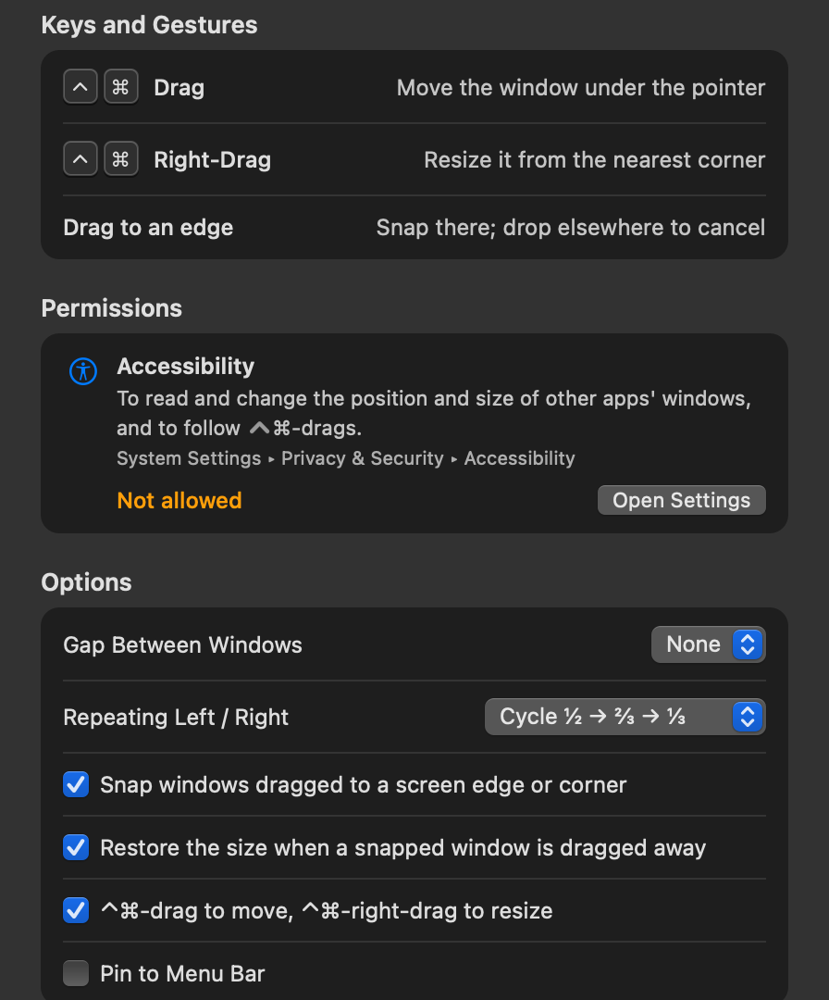</td>
</tr>
<tr>
<td valign="top">

- **Shortcuts:** every global shortcut of the gadget as key caps. Click one and type a new combination; ⌫ removes it,
  ↺ brings back the default, Esc cancels. A combination macOS reserves, another action uses, or another app already
  holds is refused with the reason. "Open in Quick Panel" opens the gadget's screen in the menu bar panel.

</td>
<td valign="top">

- **Keys and Gestures:** what works inside the gadget (⌃⌘-drag, Space while selecting, ⌘C on a float...).
- **Permissions:** each permission it needs, why, where it lives in System Settings and whether it is allowed now;
  gadgets that need none say why.
- **Options:** the gadget's choices, saved at once. **Good to Know:** what macOS does not allow.

</td>
</tr>
</table>

## Gadgets

| Gadget | What it does | Permission |
|---|---|---|
| [Menu Bar Organizer](#menu-bar-organizer) | Folds away the icons left of a divider; they come back on a click, on hover or from a shortcut | None |
| [System Monitor](#system-monitor) | CPU, memory, disk, network, sensor and battery menu bar items with panels, flyouts and alerts | None (Notifications only for alert notifications) |
| [Window Snap](#window-snap) | 24 window commands from the keyboard, drag to snap, restore, gaps, ⌃⌘-drag to move or resize | Accessibility |
| [File Shelf](#file-shelf) | A floating shelf for files, images, links and text that opens when you shake a drag | None |
| [Capture Float](#capture-float) | Captures an area, a window or the screen and keeps it floating above other windows | Screen Recording |
| [Focus Dim](#focus-dim) | Keeps the active window bright and dims everything behind it | None |

### Menu Bar Organizer

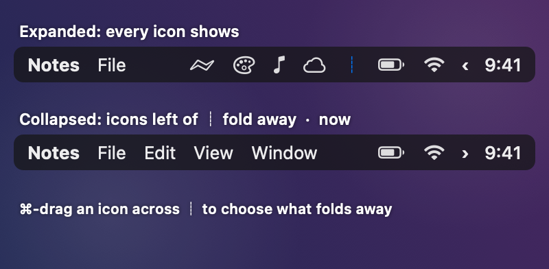

The gadget adds a toggle `‹` and a divider `┊` to the menu bar. Expanded (top), every icon shows; collapsed (bottom),
the icons left of `┊` fold away and the app menus get their room back. You choose what folds away by ⌘-dragging icons
across `┊`.

- **Click `‹`** to expand or collapse; **⌥-click** (or right-click) shows the always-hidden icons too.
- **Auto-collapse** after 5–60 seconds (default 10 s). The countdown waits while the pointer is in the menu bar.
- **Expand on hover:** rest the pointer on `‹` for a moment instead of clicking (opt-in).
- **Always-hidden section:** a second divider; icons left of it stay hidden even when expanded (opt-in).
- **Shortcuts** for expand / collapse and for the always-hidden icons (none by default).
- No permission: the gadget only owns its own items, a divider that grows to push the icons on its left out of view. It
  never reads, records or moves other apps' icons. If macOS refuses to let the divider grow, the gallery says so and the
  bar stays expanded. Details: [docs/MENUBAR-CONSTRAINTS.md](docs/MENUBAR-CONSTRAINTS.md).

### System Monitor

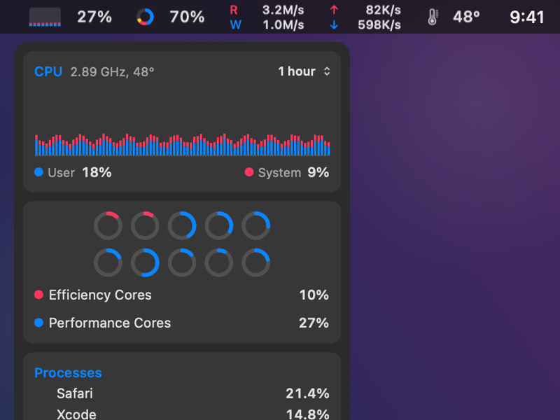

Each metric group gets its own menu bar item: CPU graph and %, memory ring and %, disk read / write, network up / down,
CPU temperature and, opt-in, the battery. Clicking one opens its detail panel; it closes on an outside click, Esc or a
Space change.

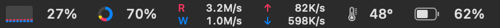

Resting the pointer on a panel card outlines it in blue and opens a **flyout** with a larger chart beside the panel.
Move into the flyout to change its range (10 min – 24 h) or metric (⌃⌄ next to the title).

<table>
<tr>
<td width="62%" valign="top">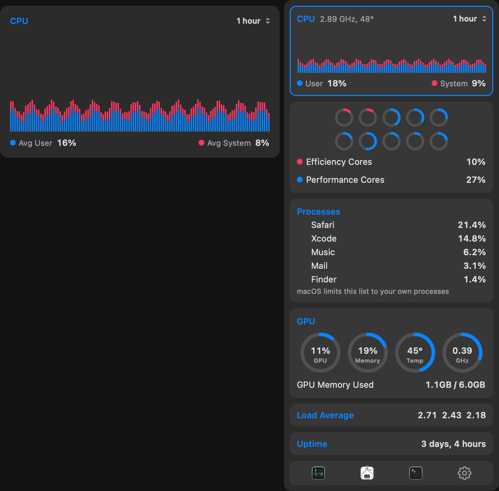</td>
<td width="38%" valign="top">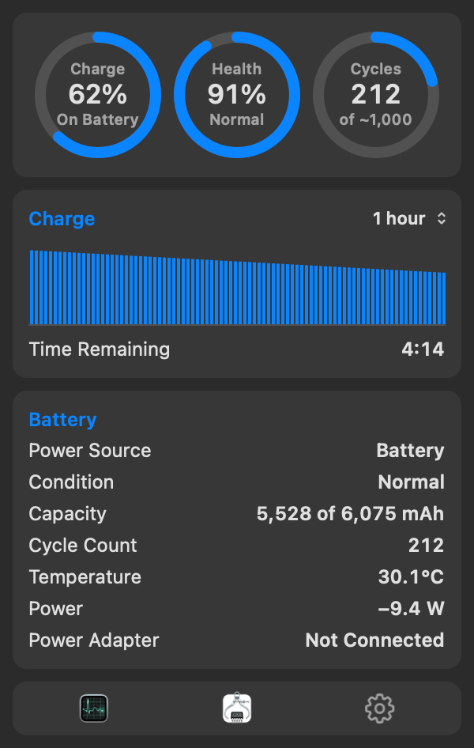</td>
</tr>
<tr>
<td valign="top">CPU panel: user / system history, efficiency and performance cores, top processes, GPU, load average and
uptime. The hovered chart card opens its flyout with period averages.</td>
<td valign="top">Battery panel: charge, health and cycle rings, charge history, time remaining or until full, source,
condition, capacity, temperature, power in / out and the adapter.</td>
</tr>
</table>

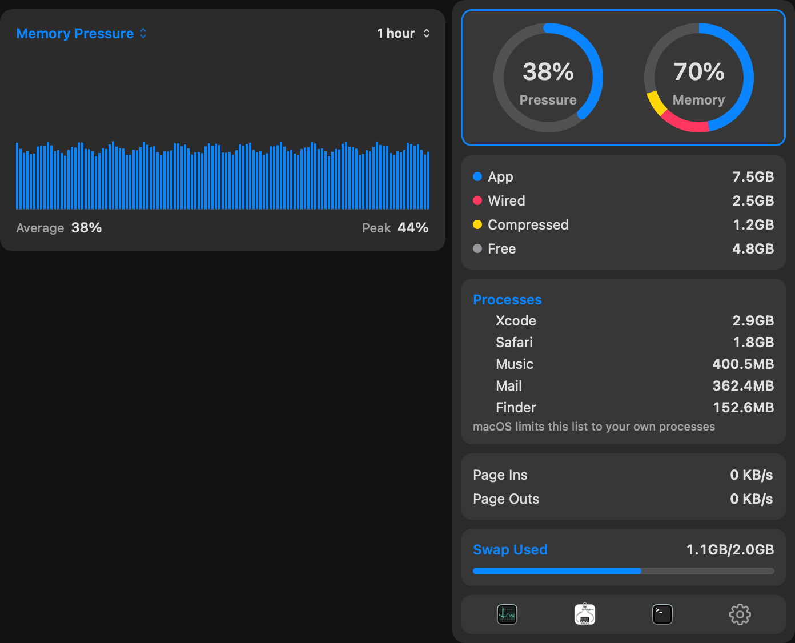

Memory panel: pressure and usage rings (app, wired, compressed), top processes, page ins / outs and swap; the flyout
charts memory pressure (or usage) over the chosen period.

| Panel | Contents |
|---|---|
| CPU | User / system history, per-core gauges (efficiency cores pink, performance cores blue), top processes, GPU (utilization, memory, temperature, clock), load average, uptime |
| Memory | Pressure and usage rings (app, wired, compressed), top processes, page ins / outs, swap used |
| Disk | Startup volume usage, read / write rates and history, peaks in the period, totals since boot, per-process R / W |
| Network | Upload / download rates and history, interfaces, public IP (opt-in), local IPs, per-process ↑ / ↓ |
| Sensors | CPU / GPU temperature and clock, fans, temperature sensor list, total power history |
| Battery | Charge, health and cycle rings, charge history, time remaining / until full, power source, condition, capacity, temperature, power in / out, adapter |

| Card | Flyout |
|---|---|
| CPU chart | User / system history with period averages |
| Cores | Performance / efficiency core average history |
| GPU | Processor / memory / temperature / clock history |
| Load average | 1 / 5 / 15 min history |
| Memory rings | Memory pressure / usage history |
| App, wired, compressed | Stacked history by category |
| Page ins / outs, swap | Paging rates, swap used history |
| Startup volume | Used / purgeable / free ring, SSD health (NVMe SMART endurance) and temperature |
| Disk activity | Read / write history, peaks in the period, totals since boot |
| Network | Upload / download history, peaks in the period |
| Sensor rings, power, fans | CPU / GPU temperature and fan speed, total power, fan speed history |

- **Alerts:** CPU at or above the chosen level (70–95 %, default 90 %) for 30 s, memory pressure warning for 10 s, a
  startup disk 90 % full, a CPU at 95 °C for 20 s, and a battery at 10 % while unplugged. An alert ends only after the
  value has been calm for a while (30 s for memory), so a value at the edge does not flap. The gallery badge counts
  active alerts; notifications are optional (Notifications permission).
- **Chart ranges:** 10 min / 1 hour / 3 hours / 24 hours, chosen per chart and saved (flyouts separately). History is
  kept in memory only, for 24 hours, and is cleared on restart.
- **Data sources and limits:**
  - Public APIs: Mach host statistics (CPU, memory), sysctl (pressure, swap, load), the IOKit registry (disk totals, GPU
    utilization), getifaddrs and SystemConfiguration (network), the IOKit power source API and the AppleSmartBattery
    registry entry (battery).
  - Process statistics use `proc_pid_rusage` and count **only processes owned by your account** (macOS refuses
    root-owned ones). Helper processes are summed per app bundle.
  - Per-process network traffic runs a single `/usr/bin/nettop` snapshot every 2 s, only while the network panel is
    open, and diffs the results.
  - Temperatures, fans and power come from (undocumented) SMC keys; CPU / GPU clocks from the private IOReport library
    (dlopen). Anything missing or failing shows "–" and does not affect the rest. Per-core temperature names are used
    only on M1 Pro / M1 Max, where the key layout was checked; other Apple silicon shows the CPU average and maximum.
  - SSD health and temperature come from the NVMe SMART interface in the public header
    `IOKit/storage/nvme/NVMeSMARTLibExternal.h` (no permission needed). Health = 100 − endurance used. It is read only
    while the disk panel is open, once a minute.
  - The public IP is an external request (`https://www.cloudflare.com/cdn-cgi/trace`), so it is OFF by default. It is
    requested only from the panel's "Look Up" button or when auto lookup is turned on in the gallery.
  - Fan speeds are shown but not controlled (that needs a privileged helper).

### Window Snap

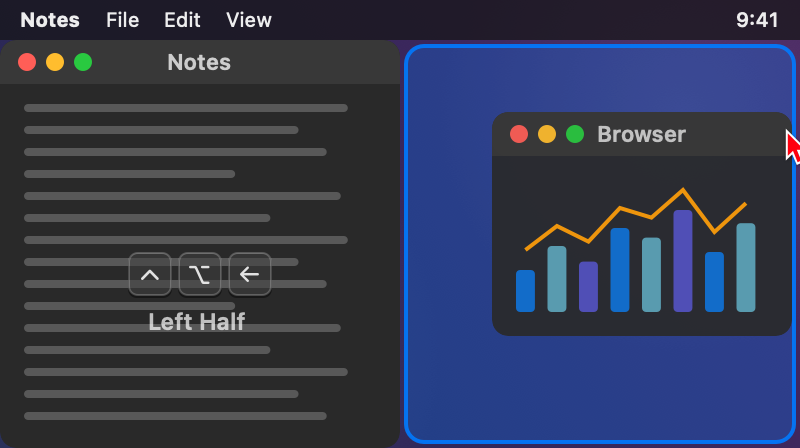

Snap the front window from the keyboard (left: ⌃⌥← puts it on the left half) or with the mouse (right: a window dragged
to the right edge shows where it will land).

- **24 commands:** halves, quarters, thirds, two thirds, center half, maximize, almost maximize, maximize height,
  center, larger, smaller, restore, next / previous display. On a portrait display the thirds stack top to bottom.
- **Repeat to cycle:** pressing left / right half again gives ⅔, then ⅓ (or moves to the neighbouring display, or does
  nothing: an option).
- **Drag to snap:** corners give quarters, the left / right edge halves (near a corner the top / bottom half), the top
  edge maximizes, the bottom edge gives thirds. On macOS 15 and later, while "Drag windows to screen edges to tile" is on
  in Desktop & Dock, edge drags are left to macOS.
- **Restore:** a snapped window dragged away gets its earlier size back; ⌃⌥⌫ restores it too.
- **Window motion:** ⌃⌘-drag anywhere inside a window moves it; ⌃⌘-right-drag resizes it from the nearest corner.
- **Gaps** of 4–24 pt between windows and screen edges (option).
- Needs **Accessibility**, to read and change other apps' window frames and to follow ⌃⌘-drags. Windows cannot be moved
  between Spaces (no public API).

### File Shelf

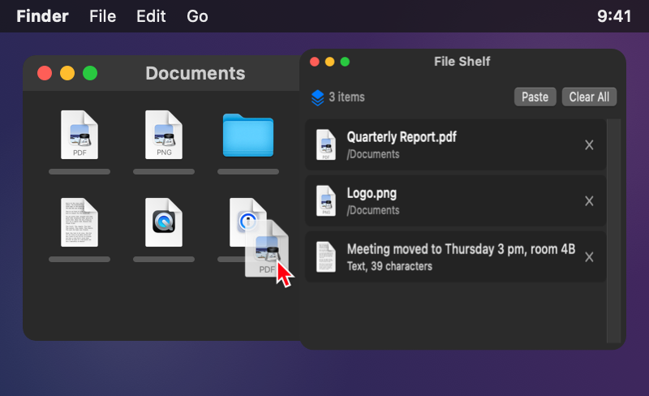

A floating shelf to park things while you move between apps. Drop on it, drag out again.

- **Opens by itself:** shake the pointer while dragging and the shelf appears under it (or on any drag, or only from
  its shortcut ⌃⌥S: an option).
- **Holds anything:** files and folders, promised files from browsers / Photos / Mail, images, web links and text.
- **Drag out** one item, or all of them at once with the stack handle (`3 items`). Dragging out always copies; originals
  are never moved or deleted.
- **Keys:** Space = Quick Look, ⌫ = remove, ⌘Z = bring back what you removed, ⌘V = add the clipboard, ⌘C = copy,
  double-click opens. Right-click a row for Open, Quick Look, Show in Finder, Copy, Remove.
- No permission: drags are noticed from mouse events, and nothing is read unless you drop it. Turning the gadget off or
  quitting deletes only the shelf's own copies (`Shelf/`).

### Capture Float

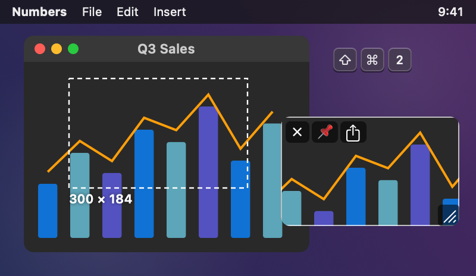

Capture part of the screen and keep it floating above your work as a reference.

- **Capture:** ⇧⌘2 then drag an area (the size is shown while you drag); press Space to pick a window instead. The gallery
  and the quick panel also capture the whole screen or the previous area again.
- **Floats** stay on top on every Space and over full-screen apps, with close ✕, pin 📌, share ⇪ (drag the picture into
  another app) and a resize grip.
- **Opacity:** scroll over a float to fade it and compare it with what is underneath.
- **Lock:** make all floats click-through; unlock them from the gallery, the quick panel or a shortcut.
- **Copy Text:** recognises text and QR codes in a float (on this Mac, with Vision) and copies them.
- Needs **Screen Recording**, to read the pixels of the area you select. macOS 15 and later ask again about once a month.
  The system screenshot shortcuts (⇧⌘3, ⇧⌘4, ⇧⌘5) stay with macOS. Nothing is recorded or uploaded.

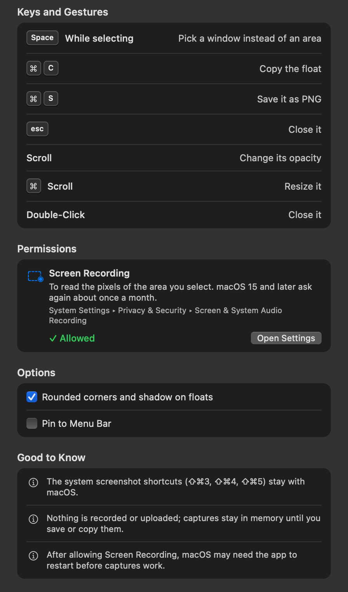

### Focus Dim

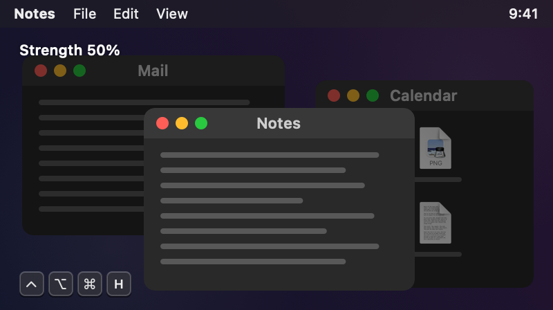

Everything behind the window you are working in darkens, so it stands out. The menu bar and Dock stay clear and the
shade never catches a click; clicking the desktop shows everything.

- **Strength** 10–90 % (slider in the gallery and the quick panel).
- **Pause:** ⌃⌥⌘H pauses and resumes dimming without switching the gadget off.
- **Keep bright:** only the front window, or every window of the active app.
- **Displays:** dim the other displays too, or only the one you are working on.
- **Fade** 0–1 s between windows (instant while Reduce Motion is on).
- No permission: window positions come from the system window list; titles and contents are never read.

## Shortcuts
Defaults; every one can be changed or removed in the gallery.

| Gadget | Default shortcuts |
|---|---|
| Window Snap | ⌃⌥← → ↑ ↓ halves · ⌃⌥U I J K quarters · ⌃⌥D F G thirds · ⌃⌥E R T two thirds · ⌃⌥↩ maximize · ⌃⌥⇧↑ maximize height · ⌃⌥C center · ⌃⌥- / = smaller / larger · ⌃⌥⌫ restore · ⌃⌥⌘← / → previous / next display. Center half and almost maximize have none |
| File Shelf | ⌃⌥S show / hide (add clipboard: none) |
| Capture Float | ⇧⌘2 capture area (previous area, window, screen, copy text, lock, hide all, close all: none) |
| Focus Dim | ⌃⌥⌘H pause / resume |
| Menu Bar Organizer, System Monitor | none (expand / collapse, show always-hidden, open a panel: assign in the gallery) |

Shortcuts are registered only while their gadget runs. A shortcut must use two modifiers (one with a function key), must
not be a macOS combination (⇧⌘3 / 4 / 5, ⌘Space, ⌃↑...) and must not be in use by another action or open shortcut.
When another app already holds a combination, the gallery says so and keeps the previous shortcut.

## Quick panel (menu bar)

<table>
<tr>
<td width="50%" valign="top">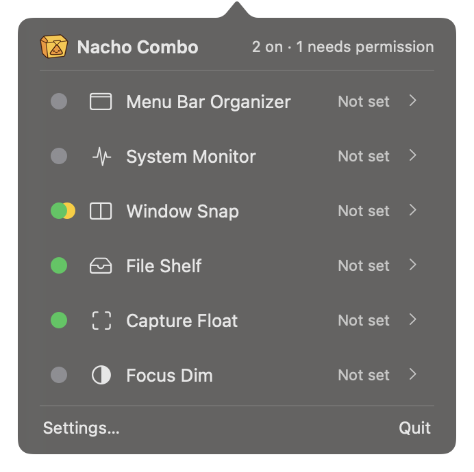</td>
<td width="50%" valign="top">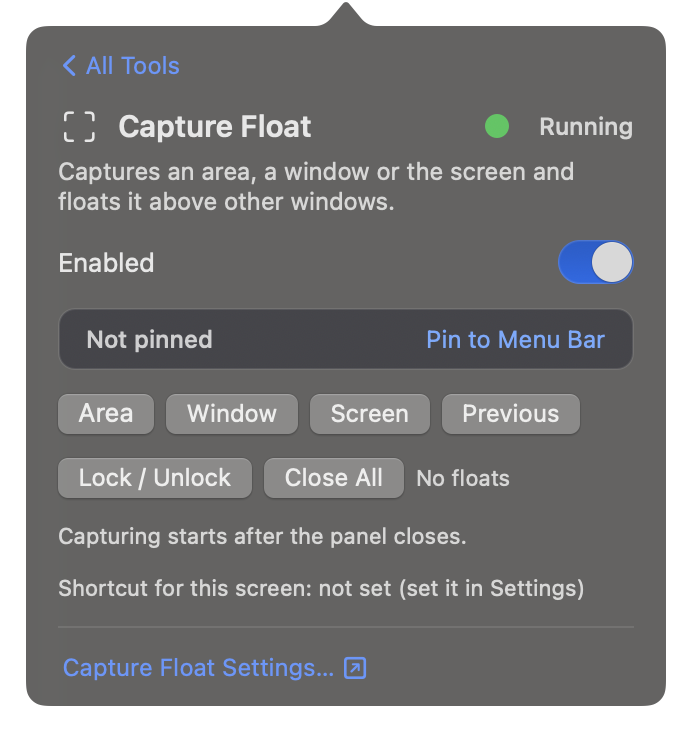</td>
</tr>
</table>

- Clicking the nacho box in the menu bar opens the **tool list** (left). Each row shows a status dot, the tool's symbol
  and name, its open-screen shortcut (`Not set` when there is none) and `›`. Clicking a tool switches the same popover to
  its **control screen** (right); `‹ All Tools` or Esc goes back.
- Status dot: green = switched on by you, gray = off. When a tool is on but needs a permission or more setup, a yellow
  dot half overlaps the green one (red for an error). The control screen always says it in words as well
  (`Running / Needs Permission / Error`).
- Control screens: Menu Bar Organizer (collapse / expand, show always-hidden), System Monitor (CPU, memory and network
  figures), Window Snap (the layout grid), File Shelf (open / close, add clipboard, item count), Capture Float (area,
  window, screen, previous area, lock, close all), Focus Dim (strength, pause). `Settings…` opens the gallery on that
  gadget.
- **Pin to the menu bar** per tool: a pinned tool gets its own menu bar icon that opens its control screen directly.
  Pinning is separate from on / off and never asks for a permission.
- **Open-screen shortcut** per tool (set in the gallery): it only opens the tool's control screen. It needs at least two
  modifiers including ⌃ or ⌥ (one for F-keys) and must not clash with an action shortcut or a macOS combination.

## Settings and the OFF contract
- Target: macOS 12 (Monterey) or later, Swift 5.5+ (Package.swift `platforms: .macOS(.v12)`).
- Settings: `~/Library/Application Support/NachoCombo/settings.json` (everything is OFF by default; includes the dim
  strength `dimIntensity`, the gadget `options`, `pinnedTools`, `toolShortcuts` and `actionShortcuts`). Settings files
  from earlier versions still load.
- OFF contract: a gadget's `stop()` releases all of its timers, monitors, event taps and status items, and its action
  shortcuts are unregistered. Counters for checking this are written to `state.json` in the same folder.

## Install (release)
- Download `NachoCombo-<version>-macos.zip` or `.dmg` and `SHA256SUMS.txt` from [Releases](../../releases). Universal
  binary (Apple Silicon + Intel), macOS 12 or later.
- Verify: `shasum -a 256 -c SHA256SUMS.txt`
- **Signing limits: the app is ad-hoc signed, without an Apple Developer ID signature or notarization.** Gatekeeper blocks
  the first launch. Right-click the app → Open → Open, or allow it in System Settings ▸ Privacy & Security. Updating or
  rebuilding changes the code signature, so Window Snap's Accessibility permission has to be granted again.
- Releases are created automatically: pushing a tag like `v0.1.0` makes GitHub Actions (`.github/workflows/release.yml`)
  build and package the app on a macOS runner.

## Build / test
- macOS: `scripts/build-app.sh` → `build/NachoCombo.app` (ad-hoc signed; the app icon, also used as the menu bar item, is
  made from `Resources/AppIcon.png`). Run it with `open build/NachoCombo.app`.
  Universal build `UNIVERSAL=1`, version `VERSION=x.y.z`, packaging `VERSION=x.y.z scripts/package.sh` (zip, dmg,
  SHA256SUMS → `dist/`).
- Core unit tests (Linux and macOS): `swift test` (on Linux the manifest leaves out the AppKit target).
- README screenshots: `scripts/screenshots.sh` (quits a running Nacho Combo, renders everything into `docs/images`).
- Debug control channel: start with `NachoCombo --debug-ctl`, then `NachoCombo ctl set systemMonitor off|on`,
  `ctl collapse on|off|all`, `ctl snap <action>` (e.g. `left`, `top-left`, `first-third`, `next-display`),
  `ctl action <id>` (e.g. `capture.area`, `dim.toggle`), `ctl actionshortcut <id> <keyCode> <carbonMods>|clear|reset`,
  `ctl option <key> <value>` (e.g. `option snapGap 8`),
  `ctl shelf show|hide|clear|undo|addfile <path>|addtext <text>|addlink <url>|paste|remove <i>`,
  `ctl capture select|window|screen|previous|text|lock|hide|closeall|rect x y w h`,
  `ctl float pin|unpin|close|copy|text|lock|unlock|width|opacity|save <i> [arg]`, `ctl dim intensity <0.1-0.9>|pause|refresh`,
  `ctl pin <module> on|off`, `ctl shortcut <module> <keyCode> <carbonMods>|clear`, `ctl panel list|tool <module>|back|close`,
  `ctl appearance dark|light|system`, `ctl dump`, `ctl quit`. Prints the state JSON (the `ui` section holds the panel,
  gallery, pin and shortcut state). Not meant for release use.
  - Gallery: `ctl gallery select <module>`, `ctl gallery sample on|off` (pictures with sample data),
    `ctl gallery detail <file.png>` (the whole detail pane), `ctl gallery preview <module> <file.png> [light]`,
    `ctl settings snapshot <file.png>`, `ctl snapshot panel <file.png>`.
  - System Monitor: `ctl monitor show cpu|memory|disk|network|sensors|battery`, `ctl monitor hide`,
    `ctl monitor items cpu,network`, `ctl monitor range <cpu|disk|network|power|battery|flyout.*> <600|3600|10800|86400>`,
    `ctl monitor publicip`, `ctl monitor snapshot <item> <file.png> [light] [sample]` (renders a panel as PNG),
    `ctl monitor menubar <file.png> [light] [sample]`.
  - Flyouts: `ctl monitor hover <n>` (opens the flyout of the open panel's n-th hover card),
    `ctl monitor flyout <item> <n> <file.png> [light] [sample]` (renders the panel and the flyout side by side as PNG).
- The signature is ad-hoc; after a rebuild, Accessibility and Screen Recording have to be allowed again.

## License
[MIT](LICENSE) © 2026 Mafianacho. The "Nacho Combo" name and logo are not covered by this license.
