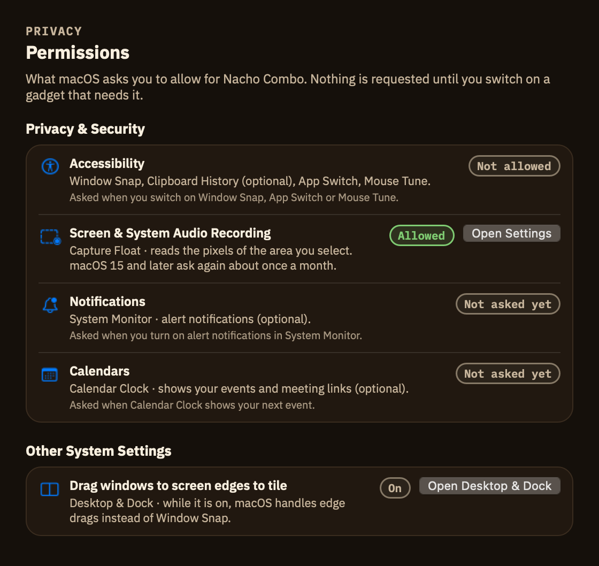
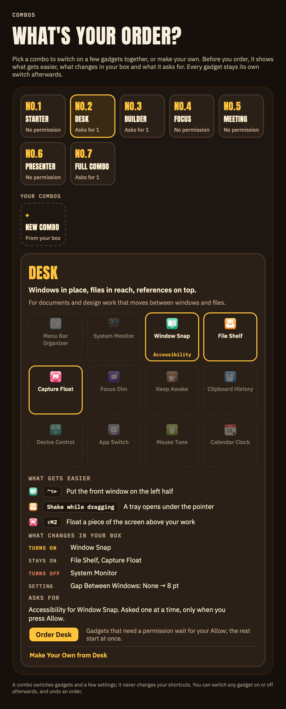
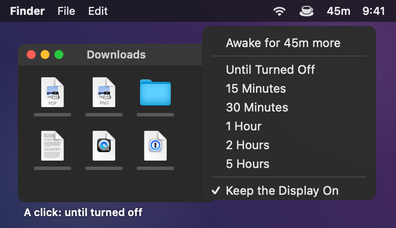
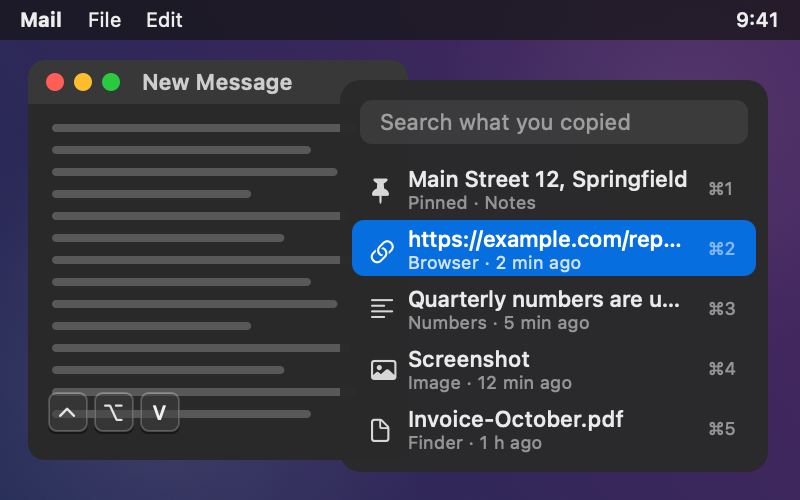
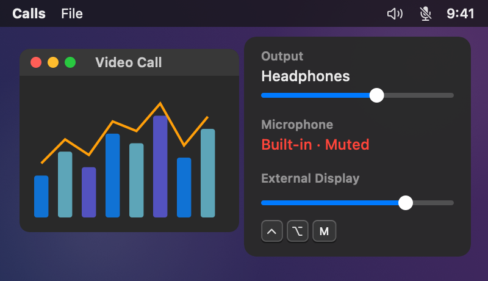
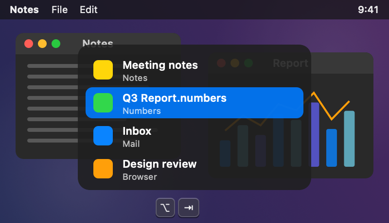
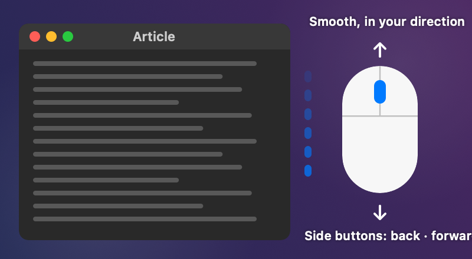
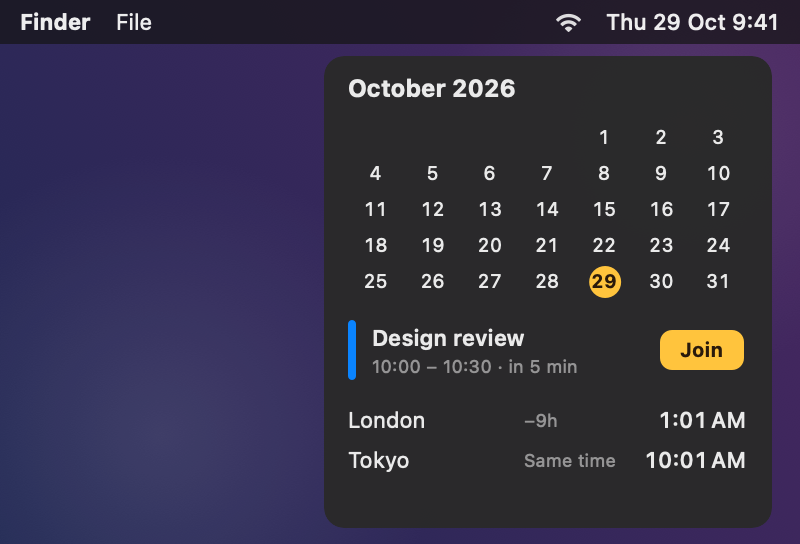
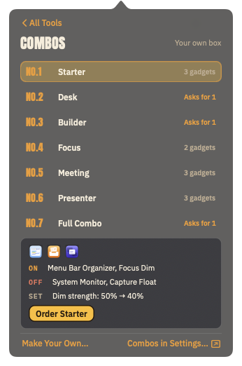

# Nacho Combo

One macOS menu bar app with twelve gadgets, each switched on or off on its own: a menu bar organizer, a system monitor,
window snapping, a file shelf, floating screen captures, focus dimming, keep awake, clipboard history, device control
(sound, microphone, external display brightness), app and window switching, mouse tuning and a calendar clock. Order
them one by one or as a combo. No third-party apps, code or brands are used; the brand fonts are open-licensed
([Brand](#brand)).

The app lives in the menu bar as its nacho box icon and has no Dock icon. Opening the app shows the **settings window**
above: a sidebar on the left and, first, the **gadget gallery** with every gadget as a tile and its switch.

> The screenshots are rendered by the app itself (`scripts/screenshots.sh`). Where a gadget works on other apps'
> windows, the desktop around it is drawn; System Monitor pictures use sample numbers.

## Contents
- [Usage](#usage)
- [The settings window](#the-settings-window) · [Combos](#combos) · [Permissions](#permissions) · [Brand](#brand)
- [Gadgets](#gadgets): [Menu Bar Organizer](#menu-bar-organizer) · [System Monitor](#system-monitor) ·
  [Window Snap](#window-snap) · [File Shelf](#file-shelf) · [Capture Float](#capture-float) · [Focus Dim](#focus-dim) ·
  [Keep Awake](#keep-awake) · [Clipboard History](#clipboard-history) · [Device Control](#device-control) ·
  [App Switch](#app-switch) · [Mouse Tune](#mouse-tune) · [Calendar Clock](#calendar-clock)
- [Shortcuts](#shortcuts)
- [Quick panel](#quick-panel-menu-bar)
- [Install](#install-release) · [Build / test](#build--test) · [License](#license)

## Usage
1. Double-click `NachoCombo.app` (it is ad-hoc signed and not notarized, so the first launch may need right-click ▸ Open).
2. The first launch opens the combo menu ("What's your order?"): order a combo, or switch gadgets on one by one in
   the gadget gallery. Click a tile to open a gadget's page.
3. Gadgets that need a permission (Window Snap, App Switch and Mouse Tune = Accessibility, Capture Float = Screen
   Recording) say so on their tile
   while they are off, explain it in a short sheet when you switch them on, and only then let macOS show its own dialog.
   Until it is allowed, the gadget's page shows the steps and notices by itself when you have allowed it
   ([Permissions](#permissions)).
4. Closing the window keeps the gadgets that are on running. Right-clicking the nacho box in the menu bar ▸ `Settings…`,
   `Settings…` in its panel, or opening the app again brings it back. `Quit Nacho Combo` (General, the panel or the
   menu) cleans up all monitoring, shortcuts and overlays.
5. Choices are saved automatically and restored on the next launch. General ▸ Open at Login adds Nacho Combo to Login
   Items (macOS 13 and later); Show This Window at Launch chooses when the window opens by itself.

## The settings window

The window can be resized; its size and the last page come back next time.

**Sidebar.** All Gadgets (the gallery), Combos, General, Permissions (with a count when something needs you), then every gadget
with its state: green = running, orange = switched on but waiting for you (a permission), red = error, nothing = off.
↑ / ↓ move between entries.

**All Gadgets.** The yellow lid on top shows what runs, what waits for you and which combo the box is (`Your box: Desk`,
or `Start from a combo`). Each tile shows the gadget's icon, its name, one status slot and its own on / off switch. The slot holds
what matters most: its main shortcut (`⌃⌥S · Empty`, `⇧⌘2`), live numbers (`CPU 18% · Memory 85%`), `Off`, a lock with
the permission it will ask for (`Accessibility`, while off), or, while it waits for one, an orange **Allow
Accessibility…** button that opens its page. Every state uses the same slot, so the icon, the name and the switch never
move. An orange badge on the icon says something needs attention (`!` for one thing, a number from two). The header
counts what runs (`2 running`) and names what waits (`1 needs Accessibility ›`, which opens it). Click a tile to open
its page; arrow keys move a highlight, Return opens, Space flips the switch.

**A gadget's page.** From top to bottom:

<table>
<tr>
<td width="50%" valign="top"></td>
<td width="50%" valign="top">

- **Header:** icon, name, one sentence, the real state (`Running`, `Off`, `Needs Accessibility`) and its switch.
- **What to do:** the permission card ([Permissions](#permissions)), a one-time setup step (Menu Bar Organizer:
  ⌘-drag the icons to hide left of `┊`), and notices (errors, a shortcut another app holds, System Monitor alerts).
- **Overview:** the gadget at work, drawn by its own views and following your settings; Controls to use it right away
  (Window Snap's grid of 18 layouts, buttons, sliders; `Turn On` while it is off); Features; Keys and Gestures; Good to
  Know (what macOS does not allow).
- **Settings:** its Options (saved at once, with a note when a system setting stands in the way), Menu Bar Access (pin
  it to the menu bar, a shortcut that opens its controls) and the state of each permission it uses. A gadget that is on
  opens here; one that is off opens on Overview.

</td>
</tr>
</table>

<table>
<tr>
<td width="50%" valign="top"></td>
<td width="50%" valign="top"></td>
</tr>
<tr>
<td valign="top">

- **Shortcuts:** how many are set, how many another app holds, and `Restore Defaults…` for this gadget. Window Snap's
  24 are grouped (Halves, Quarters, Thirds, Two Thirds, Size and Position, Displays); a group with a clash opens by
  itself. Click a key cap field and type a new combination; ⌫ removes it, ↺ brings back the default, Esc cancels. A
  combination macOS reserves, another action uses, or another app already holds is refused with the reason.

</td>
<td valign="top">

- **Permissions:** everything macOS asks you to allow, who uses it and why, its state and the one thing to do; plus
  the system setting Window Snap depends on (Desktop & Dock tiling, macOS 15 and later).
- **General:** Open at Login, Show This Window at Launch (Always / When Something Needs You / Never), the dot on the
  menu bar icon, the settings file, Reset All Settings, the version and Quit.

</td>
</tr>
</table>

## Combos

A combo switches on a few gadgets together and tunes a few options for one way of working. Before you order, the board
shows what it lights up, what gets easier (with your own shortcuts), what changes in your box and which permissions it
asks for. Afterwards every gadget is still its own switch; a combo never changes shortcuts.

| Combo | Gadgets | Tunes | Asks for |
|---|---|---|---|
| No.1 Starter | Menu Bar Organizer, File Shelf, Focus Dim | Dim strength 40% | Nothing |
| No.2 Desk | Window Snap, File Shelf, Capture Float | Gap between windows 8 pt | Accessibility, Screen Recording |
| No.3 Builder | System Monitor, Window Snap, Menu Bar Organizer | Menu bar items: CPU, Memory, Network | Accessibility |
| No.4 Focus | Focus Dim, Menu Bar Organizer | Dim 60% on every display, collapse after 5 s | Nothing |
| No.5 Meeting | Calendar Clock, Device Control, Keep Awake | Keep Awake keeps the display on | Nothing |
| No.6 Presenter | Menu Bar Organizer, Focus Dim, Keep Awake | Dim 70% on every display, no auto-collapse | Nothing |
| No.7 Full Combo | All twelve | Nothing | Accessibility, Screen Recording |

Ordering never raises a system dialog: a gadget whose permission is missing waits under "To finish" with its own
`Allow …` button, which shows the usual explanation sheet and then macOS's dialog. Right after an order, `Undo` puts
the box back as it was (switches and settings), for a few minutes or until the next order.

**Your own combos.** Up to five, numbered on from No.8 under "Your combos". `New Combo` starts from the gadgets that are
on now; `Make Your Own from Desk` starts from a preset. Name it, tap the gadgets in the tray to put them in or take them
out, and choose the settings it brings for the gadgets in it (gap between windows, dim strength and other displays,
collapse delay, System Monitor's menu bar items; "Keep as it is" leaves yours alone). What gets easier and what it asks
for update as you go. A combo of your own can be edited or deleted later; deleting it leaves the gadgets as they are.

**From the menu bar.** The tool list starts with a `Combo` row (which combo the box is). It opens the combo screen: pick
one to see what it turns on and off and which settings it changes, then `Order`; `Undo` and `Make Your Own…` are there
too. Right-clicking the nacho box has a `Combo` submenu that orders a combo directly (the current one is checked); a combo
that still needs a permission continues on the Combos page.

## Permissions

Four gadgets need a permission, and nothing is asked before you switch one on: Window Snap, App Switch and Mouse Tune
(Accessibility) and Capture Float (Screen Recording). Three are optional: Accessibility lets Clipboard History paste
into the app you were in (otherwise it copies), Calendars lets Calendar Clock show your events, and Notifications are
for System Monitor alerts.

1. **Before:** a tile that will ask shows a lock and the permission's name while it is off. Switching it on shows a
   short sheet (what it needs and why, what macOS will show next); `Continue` lets macOS show its own dialog, `Not Now`
   leaves the gadget off.
2. **Steps:** until it is allowed, the gadget's page starts with one card: open the list (`Open System Settings` goes
   straight there; only the path of the running macOS is shown), turn on Nacho Combo (or add it with +), come back.
   While System Settings is in front the card waits for you.
3. **Noticed by itself:** while a gadget waits, Nacho Combo checks once a second (for up to 10 minutes at a time) and
   starts it as soon as macOS allows it; the card says `Accessibility allowed. Window Snap is running.` and, if you came
   from the card, the window comes back.
4. **Screen Recording:** macOS often applies it only after the app restarts. Back from System Settings and still not
   allowed, the card offers `Restart Nacho Combo` (gadgets that are on come back on; floats on screen close).
5. **After an update:** the app is ad-hoc signed, so macOS treats every build as a new app and the old entry no longer
   counts, even if its switch still looks on. Nacho Combo remembers which copy had the permission and says so;
   `Ask Again` removes the old entry (`tccutil reset <service> com.mafianacho.nachocombo`, no administrator needed for
   its own entry) and asks macOS again.

The menu bar shows it too: an orange dot on the nacho box (General can turn it off), and a line at the top of the tool
list (`Window Snap needs Accessibility  Allow…`).

## Gadgets

| Gadget | What it does | Permission |
|---|---|---|
| [Menu Bar Organizer](#menu-bar-organizer) | Folds away the icons left of a divider; they come back on a click, on hover or from a shortcut | None |
| [System Monitor](#system-monitor) | CPU, memory, disk, network, sensor and battery menu bar items with panels, flyouts and alerts | None (Notifications only for alert notifications) |
| [Window Snap](#window-snap) | 24 window commands from the keyboard, drag to snap, restore, gaps, ⌃⌘-drag to move or resize | Accessibility |
| [File Shelf](#file-shelf) | A floating shelf for files, images, links and text that opens when you shake a drag | None |
| [Capture Float](#capture-float) | Captures an area, a window or the screen and keeps it floating above other windows | Screen Recording |
| [Focus Dim](#focus-dim) | Keeps the active window bright and dims everything behind it; focus sessions with a countdown | None |
| [Keep Awake](#keep-awake) | Keeps the Mac (and the display) awake by hand, for a while or while chosen apps run | None |
| [Clipboard History](#clipboard-history) | Remembers copies; search, pin and paste them again, or send them to File Shelf | None (Accessibility to paste directly) |
| [Device Control](#device-control) | Sound output and volume, microphone mute, preferred devices, external display brightness | None |
| [App Switch](#app-switch) | Shortcuts that open, bring forward or hide apps, and an ⌥Tab switcher for every window | Accessibility |
| [Mouse Tune](#mouse-tune) | A wheel mouse's own scroll direction, smooth scrolling, speed and back / forward buttons | Accessibility |
| [Calendar Clock](#calendar-clock) | A clock your way with a month calendar, the next meeting's Join button and world clocks | None (Calendars for events) |

### Menu Bar Organizer

The gadget adds a toggle `‹` and a divider `┊` to the menu bar. Expanded (top), every icon shows; collapsed (bottom),
the icons left of `┊` fold away and the app menus get their room back. You choose what folds away by ⌘-dragging icons
across `┊`.

- **Click `‹`** to expand or collapse; **⌥-click** (or right-click) shows the always-hidden icons too.
- **Auto-collapse** after 5–60 seconds (default 10 s). The countdown waits while the pointer is in the menu bar.
- **Expand on hover:** rest the pointer on `‹` for a moment instead of clicking (opt-in).
- **Always-hidden section:** a second divider; icons left of it stay hidden even when expanded (opt-in).
- **Shortcuts** for expand / collapse and for the always-hidden icons (none by default).
- No permission: the gadget only owns its own items, a divider that grows to push the icons on its left out of view. It
  never reads, records or moves other apps' icons. If macOS refuses to let the divider grow, its page says so and the
  bar stays expanded. Details: [docs/MENUBAR-CONSTRAINTS.md](docs/MENUBAR-CONSTRAINTS.md).

### System Monitor

Each metric group gets its own menu bar item: CPU graph and %, memory ring and %, disk read / write, network up / down,
CPU temperature and, opt-in, the battery. Clicking one opens its detail panel; it closes on an outside click, Esc or a
Space change.

Resting the pointer on a panel card outlines it in blue and opens a **flyout** with a larger chart beside the panel.
Move into the flyout to change its range (10 min – 24 h) or metric (⌃⌄ next to the title).

<table>
<tr>
<td width="62%" valign="top"></td>
<td width="38%" valign="top"></td>
</tr>
<tr>
<td valign="top">CPU panel: user / system history, efficiency and performance cores, top processes, GPU, load average and
uptime. The hovered chart card opens its flyout with period averages.</td>
<td valign="top">Battery panel: charge, health and cycle rings, charge history, time remaining or until full, source,
condition, capacity, temperature, power in / out and the adapter.</td>
</tr>
</table>

Memory panel: pressure and usage rings (app, wired, compressed), top processes, page ins / outs and swap; the flyout
charts memory pressure (or usage) over the chosen period.

| Panel | Contents |
|---|---|
| CPU | User / system history, per-core gauges (efficiency cores pink, performance cores blue), top processes, GPU (utilization, memory, temperature, clock), load average, uptime |
| Memory | Pressure and usage rings (app, wired, compressed), top processes, page ins / outs, swap used |
| Disk | Startup volume usage, read / write rates and history, peaks in the period, totals since boot, per-process R / W |
| Network | Upload / download rates and history, interfaces, public IP (opt-in), local IPs, per-process ↑ / ↓ |
| Sensors | CPU / GPU temperature and clock, fans, temperature sensor list, total power history |
| Battery | Charge, health and cycle rings, charge history, time remaining / until full, power source, condition, capacity, temperature, power in / out, adapter |

| Card | Flyout |
|---|---|
| CPU chart | User / system history with period averages |
| Cores | Performance / efficiency core average history |
| GPU | Processor / memory / temperature / clock history |
| Load average | 1 / 5 / 15 min history |
| Memory rings | Memory pressure / usage history |
| App, wired, compressed | Stacked history by category |
| Page ins / outs, swap | Paging rates, swap used history |
| Startup volume | Used / purgeable / free ring, SSD health (NVMe SMART endurance) and temperature |
| Disk activity | Read / write history, peaks in the period, totals since boot |
| Network | Upload / download history, peaks in the period |
| Sensor rings, power, fans | CPU / GPU temperature and fan speed, total power, fan speed history |

- **Alerts:** CPU at or above the chosen level (70–95 %, default 90 %) for 30 s, memory pressure warning for 10 s, a
  startup disk 90 % full, a CPU at 95 °C for 20 s, and a battery at 10 % while unplugged. An alert ends only after the
  value has been calm for a while (30 s for memory), so a value at the edge does not flap. The gallery badge counts
  active alerts; notifications are optional (Notifications permission).
- **Chart ranges:** 10 min / 1 hour / 3 hours / 24 hours, chosen per chart and saved (flyouts separately). History is
  kept in memory only, for 24 hours, and is cleared on restart.
- **Data sources and limits:**
  - Public APIs: Mach host statistics (CPU, memory), sysctl (pressure, swap, load), the IOKit registry (disk totals, GPU
    utilization), getifaddrs and SystemConfiguration (network), the IOKit power source API and the AppleSmartBattery
    registry entry (battery).
  - Process statistics use `proc_pid_rusage` and count **only processes owned by your account** (macOS refuses
    root-owned ones). Helper processes are summed per app bundle.
  - Per-process network traffic runs a single `/usr/bin/nettop` snapshot every 2 s, only while the network panel is
    open, and diffs the results.
  - Temperatures, fans and power come from (undocumented) SMC keys; CPU / GPU clocks from the private IOReport library
    (dlopen). Anything missing or failing shows "–" and does not affect the rest. Per-core temperature names are used
    only on M1 Pro / M1 Max, where the key layout was checked; other Apple silicon shows the CPU average and maximum.
  - SSD health and temperature come from the NVMe SMART interface in the public header
    `IOKit/storage/nvme/NVMeSMARTLibExternal.h` (no permission needed). Health = 100 − endurance used. It is read only
    while the disk panel is open, once a minute.
  - The public IP is an external request (`https://www.cloudflare.com/cdn-cgi/trace`), so it is OFF by default. It is
    requested only from the panel's "Look Up" button or when auto lookup is turned on in its Settings.
  - Fan speeds are shown but not controlled (that needs a privileged helper).

### Window Snap

Snap the front window from the keyboard (left: ⌃⌥← puts it on the left half) or with the mouse (right: a window dragged
to the right edge shows where it will land).

- **24 commands:** halves, quarters, thirds, two thirds, center half, maximize, almost maximize, maximize height,
  center, larger, smaller, restore, next / previous display. On a portrait display the thirds stack top to bottom.
- **Repeat to cycle:** pressing left / right half again gives ⅔, then ⅓ (or moves to the neighbouring display, or does
  nothing: an option).
- **Drag to snap:** corners give quarters, the left / right edge halves (near a corner the top / bottom half), the top
  edge maximizes, the bottom edge gives thirds. On macOS 15 and later, while "Drag windows to screen edges to tile" is on
  in Desktop & Dock, edge drags are left to macOS.
- **Restore:** a snapped window dragged away gets its earlier size back; ⌃⌥⌫ restores it too.
- **Window motion:** ⌃⌘-drag anywhere inside a window moves it; ⌃⌘-right-drag resizes it from the nearest corner.
- **Gaps** of 4–24 pt between windows and screen edges (option).
- **Layouts:** `Save Layout` remembers where every app's windows are, for the displays connected now; `Restore Layout`
  puts them back, and (an option) it happens by itself when the same displays are connected again. Windows are matched
  by app and order, never by title. Saved in `window-layouts.json` next to the settings.
- Needs **Accessibility**, to read and change other apps' window frames and to follow ⌃⌘-drags. Windows cannot be moved
  between Spaces (no public API).

### File Shelf

A floating shelf to park things while you move between apps. Drop on it, drag out again.

- **Opens by itself:** shake the pointer while dragging and the shelf appears under it (or on any drag, or only from
  its shortcut ⌃⌥S: an option).
- **Holds anything:** files and folders, promised files from browsers / Photos / Mail, images, web links and text.
- **Drag out** one item, or all of them at once with the stack handle (`3 items`). Dragging out always copies; originals
  are never moved or deleted.
- **Keys:** Space = Quick Look, ⌫ = remove, ⌘Z = bring back what you removed, ⌘V = add the clipboard, ⌘C = copy,
  double-click opens. Right-click a row for Open, Quick Look, Show in Finder, Copy, Remove.
- No permission: drags are noticed from mouse events, and nothing is read unless you drop it. Turning the gadget off or
  quitting deletes only the shelf's own copies (`Shelf/`).

### Capture Float

Capture part of the screen and keep it floating above your work as a reference.

- **Capture:** ⇧⌘2 then drag an area (the size is shown while you drag); press Space to pick a window instead. Its page
  and the quick panel also capture the whole screen or the previous area again.
- **Floats** stay on top on every Space and over full-screen apps, with close ✕, pin 📌, share ⇪ (drag the picture into
  another app) and a resize grip.
- **Opacity:** scroll over a float to fade it and compare it with what is underneath.
- **Lock:** make all floats click-through; unlock them from its page, the quick panel or a shortcut.
- **Copy Text:** recognises text and QR codes in a float (on this Mac, with Vision) and copies them.
- **Mark Up:** ✎ on a float, then drag for an arrow or ⌥-drag for a box (⌘Z undoes); copies, saves and drags include it.
- **Live Window:** pick a window and its float keeps updating, like picture in picture for any app (marked LIVE).
- **Record:** drag over an area (or press Space for a window) and it is recorded to `Recording … .mp4` on the Desktop,
  with an optional GIF of the first 15 seconds; a red item in the menu bar shows the time and stops it (macOS 12.3+).
- **Pick a Color:** the system loupe; the color's hex code is copied.
- Needs **Screen Recording**, to read the pixels of the area you select. macOS 15 and later ask again about once a month.
  The system screenshot shortcuts (⇧⌘3, ⇧⌘4, ⇧⌘5) stay with macOS. Nothing is recorded or uploaded.

### Focus Dim

Everything behind the window you are working in darkens, so it stands out. The menu bar and Dock stay clear and the
shade never catches a click; clicking the desktop shows everything.

- **Strength** 10–90 % (slider on its page and in the quick panel).
- **Pause:** ⌃⌥⌘H pauses and resumes dimming without switching the gadget off.
- **Keep bright:** only the front window, or every window of the active app.
- **Displays:** dim the other displays too, or only the one you are working on.
- **Fade** 0–1 s between windows (instant while Reduce Motion is on).
- **Focus sessions:** 15–90 minutes of focus, then an optional break, with a countdown in the menu bar while it runs.
  It can dim only during the focus part, and run one of your Shortcuts when it starts and when it ends.
- No permission: window positions come from the system window list; titles and contents are never read.

### Keep Awake

- **One click** on the cup keeps the Mac awake; another lets it sleep. Right-click it for 15 minutes to 5 hours or until
  turned off; the minutes left show next to the cup.
- **While an app runs:** choose apps (a download manager, a video call) that keep the Mac awake while they are open.
- **Display too**, or only the Mac; **battery guard** lets it sleep below a charge you choose, or only stays awake on power.
- No permission: it holds a power assertion (as video players do) and releases it when it stops.

### Clipboard History

- **⌃⌥V** opens the list at the pointer: type to search, ↩ pastes into the app you were in, ⌥↩ pastes plain text,
  ⌘1…9 paste one of the first nine.
- **Pins** (⌘P) stay at the top and are kept after a restart; ⌫ removes, ⌘S sends an item to File Shelf.
- Text keeps its formatting, links, images (up to 8 MB) and files are kept too; copies password managers mark as secret
  are skipped. The history lives in memory (pins in `clipboard-pins.json`).
- Accessibility is optional: with it the item is pasted for you, without it it is copied and you press ⌘V.

### Device Control

- **Sound output** and its volume, **microphone** choice, **⌃⌥M** mutes the microphone everywhere (a red microphone in the
  menu bar unmutes it), and a shortcut moves the sound to the next output.
- **Preferred devices:** headphones or a microphone you choose are used as soon as they connect.
- **External displays:** a brightness slider for each monitor that accepts DDC/CI (Apple silicon), and shortcuts that
  brighten or darken them all.
- No permission: devices are switched through Core Audio; nothing is recorded.

### App Switch

- **App shortcuts:** give any app a shortcut; it opens it, brings it to the front, or hides it if it is already in front.
- **Window switcher:** hold ⌥ and press Tab (⌥⇧Tab goes back) to go through every window, minimized ones too; let go to
  switch, Esc cancels. ⌘Tab stays with macOS.
- **Hide Others:** one shortcut hides every app but the one in front.
- Needs **Accessibility**, to list and raise other apps' windows.

### Mouse Tune

- **Own direction:** reverse a wheel mouse while the trackpad keeps natural scrolling.
- **Smooth scrolling** and **speed** (0.5–3× per notch); **side buttons** go back and forward (⌘[ / ⌘]); the **middle
  button** can open Mission Control.
- Trackpads and Magic Mouse are left alone. Needs **Accessibility**, to change the mouse's events; keystrokes are never read.

### Calendar Clock

- **Your clock:** date, weekday, seconds and 12 / 24 hours as you like, in your language's order.
- **Click it** for the month, the chosen day's events and **Join** for video call links; 15 minutes before a meeting its
  name and a countdown show next to the clock.
- **World clocks:** cities you add, with the time and how far ahead or behind they are.
- Calendars is optional and only for events; they are read on this Mac and never sent anywhere.

## Shortcuts
Defaults; every one can be changed or removed on the gadget's page ▸ Shortcuts.

| Gadget | Default shortcuts |
|---|---|
| Window Snap | ⌃⌥← → ↑ ↓ halves · ⌃⌥U I J K quarters · ⌃⌥D F G thirds · ⌃⌥E R T two thirds · ⌃⌥↩ maximize · ⌃⌥⇧↑ maximize height · ⌃⌥C center · ⌃⌥- / = smaller / larger · ⌃⌥⌫ restore · ⌃⌥⌘← / → previous / next display. Center half and almost maximize have none |
| File Shelf | ⌃⌥S show / hide (add clipboard: none) |
| Capture Float | ⇧⌘2 capture area (previous area, window, screen, copy text, lock, hide all, close all: none) |
| Focus Dim | ⌃⌥⌘H pause / resume (focus session: none) |
| Clipboard History | ⌃⌥V show the history (paste the last copy as plain text: none) |
| Device Control | ⌃⌥M mute / unmute the microphone (next output, brighter, darker: none) |
| App Switch | ⌥Tab / ⌥⇧Tab switch windows; app shortcuts and Hide Others: none until you set them |
| Menu Bar Organizer, System Monitor, Keep Awake, Mouse Tune, Calendar Clock | none (assign on the gadget's page) |

Shortcuts are registered only while their gadget runs. A shortcut must use two modifiers (one with a function key, and
⌥Tab / ⌥⇧Tab for the window switcher), must
not be a macOS combination (⇧⌘3 / 4 / 5, ⌘Space, ⌃↑...) and must not be in use by another action or open shortcut.
When another app already holds a combination, the gadget's page says so and keeps the previous shortcut.

## Quick panel (menu bar)

<table>
<tr>
<td width="33%" valign="top"></td>
<td width="33%" valign="top"></td>
<td width="33%" valign="top"></td>
</tr>
</table>

- Clicking the nacho box in the menu bar opens the **tool list** (left). Its first row, `Combo`, opens the combo
  screen (middle, [Combos](#combos)). Each tool row shows a status dot, the tool's symbol
  and name, its open-screen shortcut (only when one is set) and `›`. Clicking a tool switches the same popover to
  its **control screen** (right); `‹ All Tools` or Esc goes back.
- Status dot: green = running, gray = off, orange = switched on but waiting for a permission, red = error. The row
  names what it waits for (`Accessibility`), a line at the top of the list says it in a sentence with an `Allow…`
  button, and the control screen says it in words as well (`Running / Needs Accessibility / Error`).
- Control screens: Menu Bar Organizer (collapse / expand, show always-hidden), System Monitor (CPU, memory and network
  figures), Window Snap (the layout grid), File Shelf (open / close, add clipboard, item count), Capture Float (area,
  window, screen, previous area, lock, close all), Focus Dim (strength, pause). `Settings…` opens the settings window on that
  gadget.
- **Pin to the menu bar** per tool: a pinned tool gets its own menu bar icon that opens its control screen directly.
  Pinning is separate from on / off and never asks for a permission.
- **Open-screen shortcut** per tool (set on its page ▸ Settings ▸ Menu Bar Access): it only opens the tool's control screen. It needs at least two
  modifiers including ⌃ or ⌥ (one for F-keys) and must not clash with an action shortcut or a macOS combination.

## Brand

The look follows the Nacho Combo design system: the box yellow and brown ink of the app icon, a dark menu board for
combos, guac green for running, nacho orange for "you have to do something" and salsa red for errors, all in light and
dark. Type: Anton for the brand's loud lines (the name, combo names and numbers), IBM Plex Sans for text, IBM Plex Mono
for labels. Native controls (switches, pop-ups, checkboxes, text fields) keep the system font. The fonts ship in
`Resources/Fonts` under the SIL Open Font License 1.1 (`Anton-OFL.txt`, `IBMPlex-OFL.txt`) and are registered at launch;
without them the system font is used.

## Settings and the OFF contract
- Target: macOS 12 (Monterey) or later, Swift 5.5+ (Package.swift `platforms: .macOS(.v12)`).
- Settings: `~/Library/Application Support/NachoCombo/settings.json` (everything is OFF by default; includes the dim
  strength `dimIntensity`, the gadget `options`, `pinnedTools`, `toolShortcuts`, `actionShortcuts`, `launchWindow`,
  `menuBarAttentionDot`, `dismissedHints`, `combo` (the combo last ordered), `customCombos` (your own combos) and
  `permissionGrants`, the code signature of the copy that last had each permission). Settings files from earlier versions still load.
  Pinned clipboard items (`clipboard-pins.json`) and window layouts (`window-layouts.json`) have files of their own. The window's size and last page are kept in the app's
  user defaults.
- OFF contract: a gadget's `stop()` releases all of its timers, monitors, event taps and status items, and its action
  shortcuts are unregistered. Counters for checking this are written to `state.json` in the same folder.

## Install (release)
- Download `NachoCombo-<version>-macos.zip` or `.dmg` and `SHA256SUMS.txt` from [Releases](../../releases). Universal
  binary (Apple Silicon + Intel), macOS 12 or later.
- Verify: `shasum -a 256 -c SHA256SUMS.txt`
- **Signing limits: the app is ad-hoc signed, without an Apple Developer ID signature or notarization.** Gatekeeper blocks
  the first launch. Right-click the app → Open → Open, or allow it in System Settings ▸ Privacy & Security. Updating or
  rebuilding changes the code signature, so Window Snap's Accessibility permission has to be granted again.
- Releases are created automatically: pushing a tag like `v0.1.0` makes GitHub Actions (`.github/workflows/release.yml`)
  build and package the app on a macOS runner.

## Build / test
- macOS: `scripts/build-app.sh` → `build/NachoCombo.app` (ad-hoc signed; the app icon, also used as the menu bar item, is
  made from `Resources/AppIcon.png`). Run it with `open build/NachoCombo.app`.
  Universal build `UNIVERSAL=1`, version `VERSION=x.y.z`, packaging `VERSION=x.y.z scripts/package.sh` (zip, dmg,
  SHA256SUMS → `dist/`).
- Core unit tests (Linux and macOS): `swift test` (on Linux the manifest leaves out the AppKit target).
- README screenshots: `scripts/screenshots.sh` (quits a running Nacho Combo, renders everything into `docs/images`).
- Debug control channel: start with `NachoCombo --debug-ctl`, then `NachoCombo ctl set systemMonitor off|on`,
  `ctl collapse on|off|all`, `ctl snap <action>` (e.g. `left`, `top-left`, `first-third`, `next-display`),
  `ctl action <id>` (e.g. `capture.area`, `dim.toggle`), `ctl actionshortcut <id> <keyCode> <carbonMods>|clear|reset`,
  `ctl option <key> <value>` (e.g. `option snapGap 8`),
  `ctl shelf show|hide|clear|undo|addfile <path>|addtext <text>|addlink <url>|paste|remove <i>`,
  `ctl capture select|window|screen|previous|text|lock|hide|closeall|rect x y w h`,
  `ctl float pin|unpin|close|copy|text|lock|unlock|width|opacity|save <i> [arg]`, `ctl dim intensity <0.1-0.9>|pause|refresh`,
  `ctl pin <module> on|off`, `ctl shortcut <module> <keyCode> <carbonMods>|clear`, `ctl panel list|tool <module>|back|close`,
  `ctl appearance dark|light|system`, `ctl relaunch`, `ctl dump`, `ctl quit`. Prints the state JSON (the `ui` section holds the panel,
  gallery, pin and shortcut state). Not meant for release use.
  - Settings window: `ctl gallery select <module>`, `ctl gallery page home|general|permissions|<module>`,
    `ctl gallery tab overview|settings|shortcuts`, `ctl gallery page combos`, `ctl combo select|order|edit <id>`,
    `ctl combo new [preset]`, `ctl combo save`, `ctl combo undo`, `ctl combo welcome on|off`, `ctl panel combos`, `ctl gallery sample on|off` (pictures with sample data),
    `ctl gallery detail <file.png>` (the whole page), `ctl gallery content <file.png>` (the shown tab only),
    `ctl gallery preview <module> <file.png> [light]`,
    `ctl permstage accessibility|screenRecording <notAllowed|waiting|stillNotAllowed|restartNeeded|updated|auto>`
    (shows a permission card stage), `ctl allowed <module>` (the "allowed" confirmation),
    `ctl settings snapshot <file.png>`, `ctl snapshot panel <file.png>`.
  - System Monitor: `ctl monitor show cpu|memory|disk|network|sensors|battery`, `ctl monitor hide`,
    `ctl monitor items cpu,network`, `ctl monitor range <cpu|disk|network|power|battery|flyout.*> <600|3600|10800|86400>`,
    `ctl monitor publicip`, `ctl monitor snapshot <item> <file.png> [light] [sample]` (renders a panel as PNG),
    `ctl monitor menubar <file.png> [light] [sample]`.
  - Flyouts: `ctl monitor hover <n>` (opens the flyout of the open panel's n-th hover card),
    `ctl monitor flyout <item> <n> <file.png> [light] [sample]` (renders the panel and the flyout side by side as PNG).
- The signature is ad-hoc; after a rebuild, Accessibility and Screen Recording have to be allowed again.

## License
[MIT](LICENSE) © 2026 Mafianacho. The "Nacho Combo" name and logo are not covered by this license.
