## What's new in 0.11.0

_Pictures were rendered offscreen by the macOS CI runner with made-up data (not a real Mac screen). GIFs and the What's new window screenshots come from the same renders._

### The Nacho app, now in a window on your Mac
Open the Nacho app window from Nacho Pet and use your Nacho account's sections without picking up your phone.

1. Right-click the Nacho character in the corner of the screen (or open Nacho Pet's settings).
2. Choose **나초 앱 열기…** (Open Nacho app).
3. Pick a section in the left sidebar.

### See and edit what Nacho remembers
Read your memories, add one, fix a wrong one, or pause remembering.

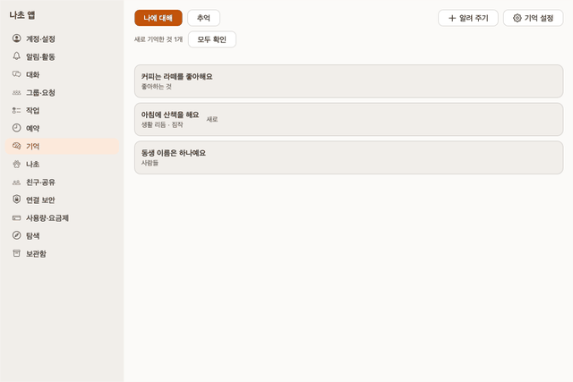

1. Open **Memory** in the sidebar.
2. Tap a memory to read or edit it, or add a new one.
3. Use **Settings** there to pause remembering.

### Notifications and activity in one place
See Nacho's alerts and friends' news together, and choose which ones you get.

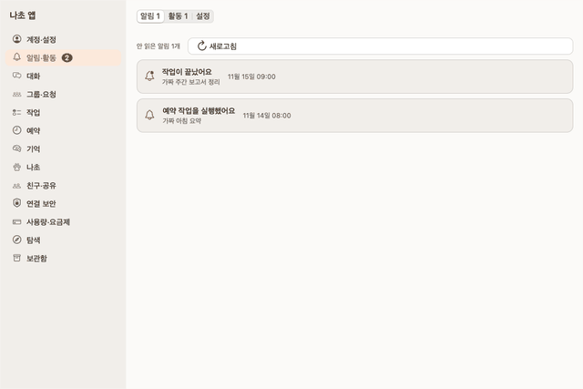

1. Open **Notifications · Activity**.
2. Switch between the list and the activity feed.
3. Open the settings to choose what is sent.

### Your conversations, searched and kept
Find a chat, search messages, and move old chats to the archive.

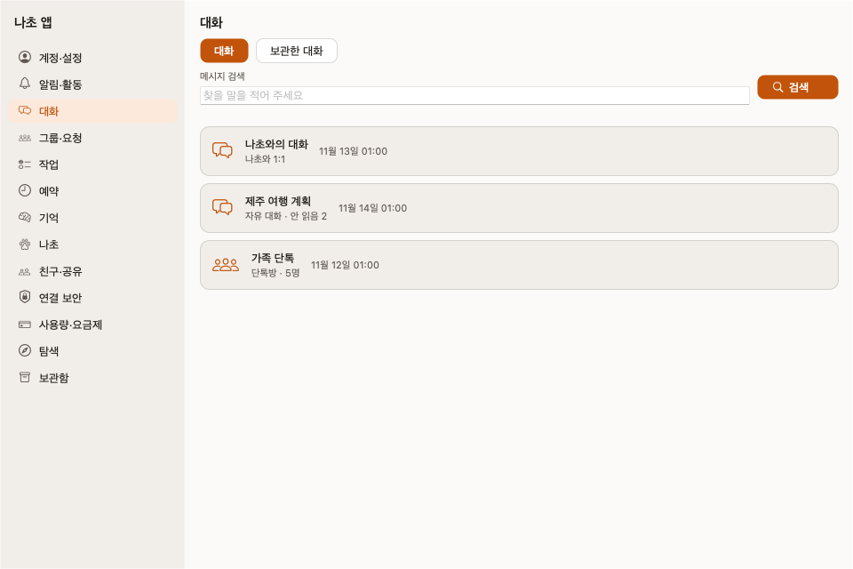

1. Open **Conversations**.
2. Type a word and press **Search**.
3. Open a conversation to rename it or keep it.

### Several rooms at once
Chat with Nacho in more than one room, such as a group chat next to your own, without losing the thread.

1. Open Nacho Pet's chat.
2. Switch to another room from the room list.
3. Ask again; each room keeps its own history.

### Groups and requests
See your groups, invitations and requests, create a group, and change its settings.

1. Open **Groups · Requests**.
2. Accept or decline an invitation.
3. Tap **Create** to start a group.

### Tasks Nacho is doing
Follow a task's plan, logs and live view, and see why one failed.

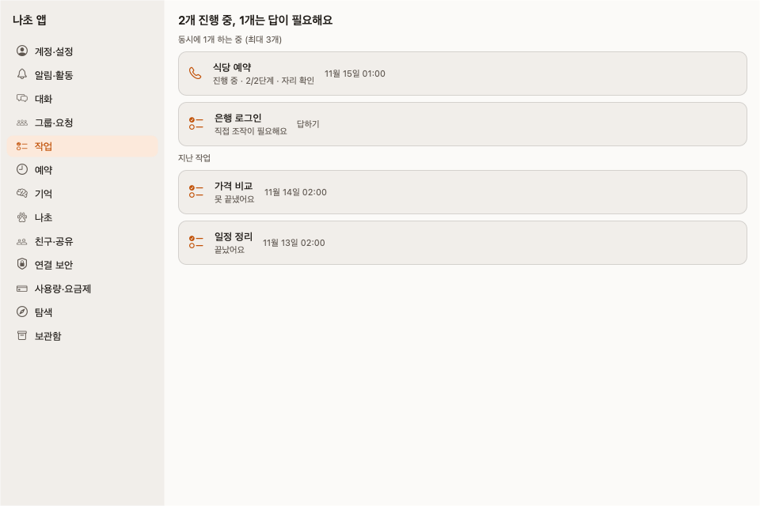

1. Open **Tasks**.
2. Tap a task to see its plan and logs.
3. Open **Live view** while it runs.

### Schedules
See what Nacho does on a schedule, read the run log, and run one now.

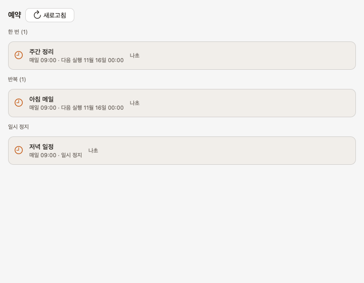

1. Open **Schedules**.
2. Tap one to see its details and run log.
3. **Run now** asks first, because it uses credits.

### Your Nachos
See your Nachos and edit their traits and voices. Making a Nacho photo asks first, because it uses credits.

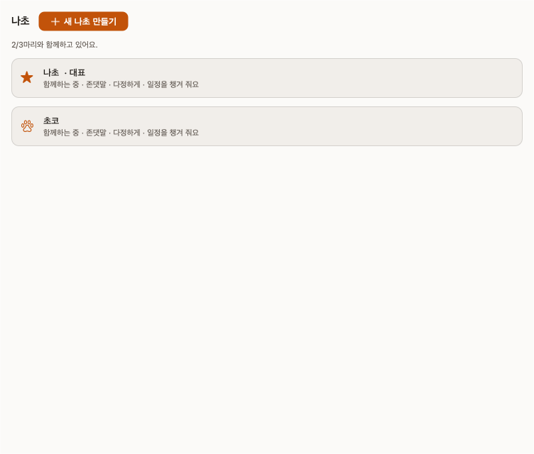

1. Open **Nacho**.
2. Pick a Nacho to see its details.
3. Edit traits or voice, or make a photo after confirming.

### Friends and sharing
See friends and requests, invite someone, and choose what you share.

1. Open **Friends · Sharing**.
2. Tap **Add** or **Invite**.
3. Open a friend to change what is shared or block them (it asks twice).

### Connection security
See which apps and devices are connected, read the log, and set rules.

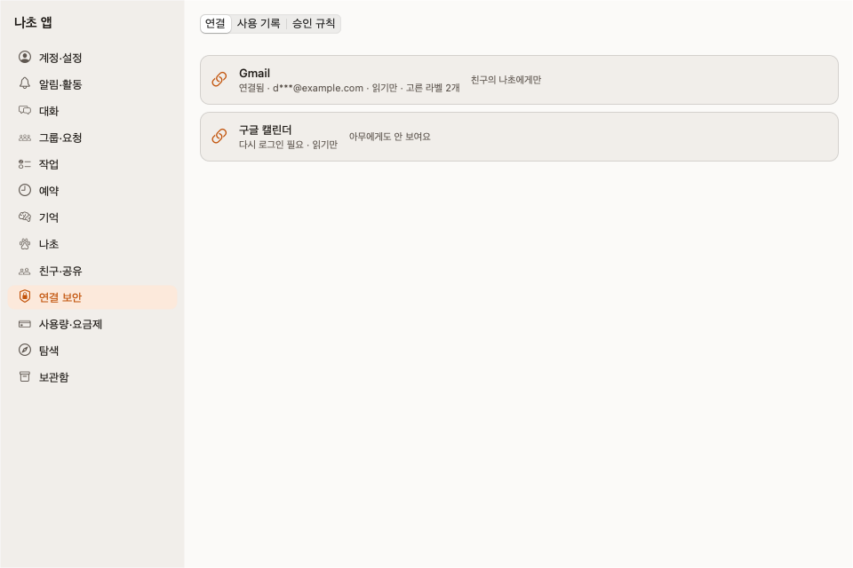

1. Open **Connection security**.
2. Tap a connection to see details.
3. Use **Rules** to allow or block.

### Usage and plans
See what you used, your credit ledger and the plans.

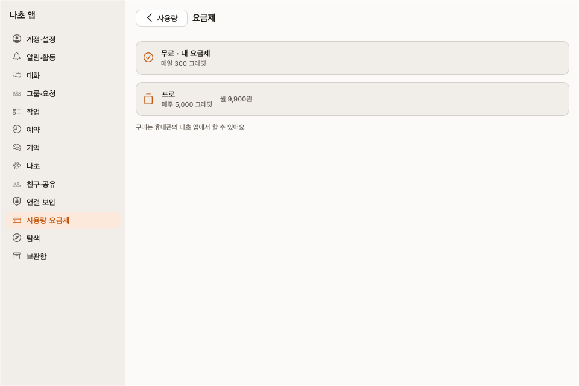

1. Open **Usage · Plans**.
2. Switch between plans and the ledger.
3. To buy credits, use the Nacho app on your phone.

### Explore
Browse suggested cards and undo what you dismissed.

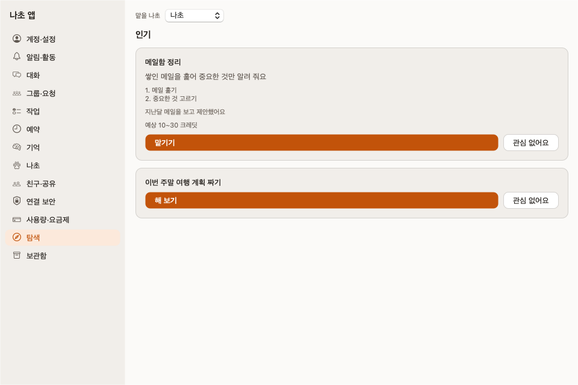

1. Open **Explore**.
2. Tap a card to open it.
3. Use **Undo** to bring a dismissed card back.

### The archive
Look at chats you kept, create one, and open its details.

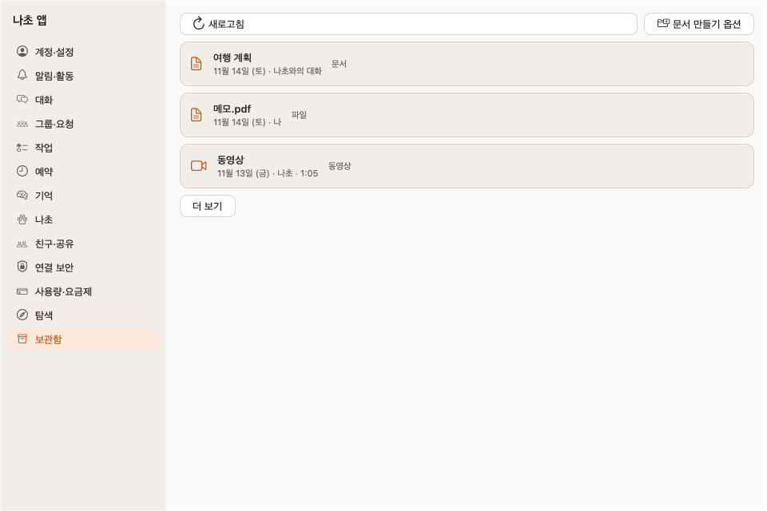

1. Open **Archive**.
2. Tap an item for its details.
3. Use **Create** to add one.

### Join Nacho from the Mac
Sign up for Nacho on the Mac. You read and agree to each term, then continue.

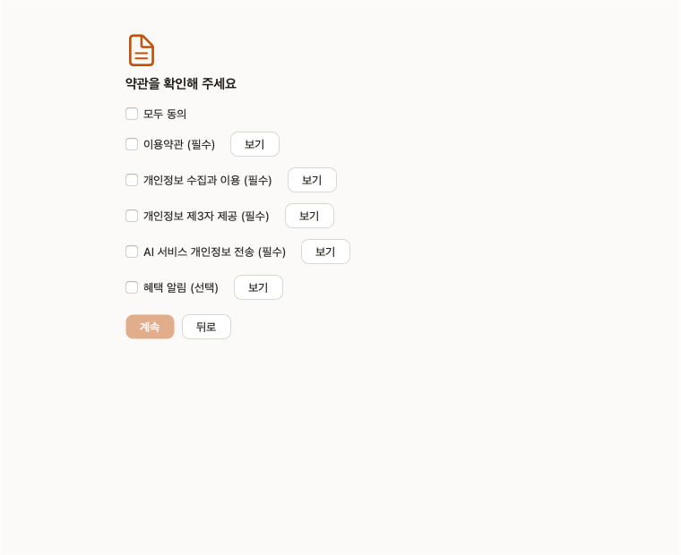

1. Choose to sign up in Nacho Pet.
2. Read each term with **View** and tick the required ones.
3. Tap **Continue**.

### A new Connections tab
Tools, connectors and gadgets are now three sections in one list. Switch each on or off, open details, add a service, turn off single Mac actions, and set **always allow** for a gadget.

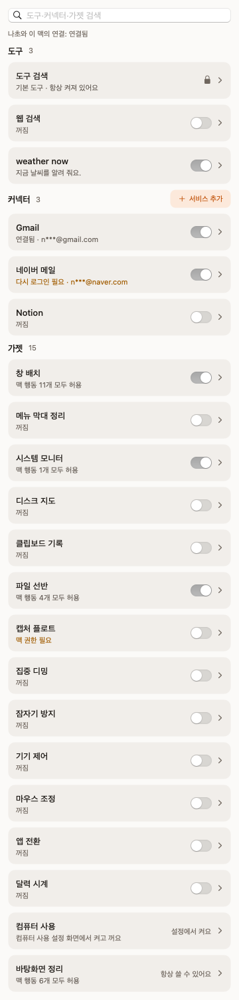

1. Open Nacho Pet's **Connections** tab.
2. Use a switch to turn one on or off.
3. Tap a row for details, or **Add service** to connect a new one.

### The What's new window
After an update, a window shows what changed, one card at a time.

1. Update the app and open it.
2. Read the card, then go on with **Next** (or back with **Previous**).
3. Close the window when you are done.

## Not in this version
- **Voice calls, buying credits, and typing a login or security code on a card.** These stay in the Nacho app on your phone; the Mac only tells you to use it.

## Off by default
- **Deleting your account** and **deleting all memories** are switched off. Nothing in the window can run them.

## Uses credits
- **Run a schedule now** and **make a Nacho photo** use credits. A confirm window appears before they start.

## Known issues (low, next version)
- A `not_found` error can show the attachment message by mistake.
- Changing a memory's visibility from shared to own can show the wrong error text.

## Not yet tried on a real Mac
Everything above was checked with tests and offscreen renders in CI only (macOS runner, ad-hoc signed app). Pictures are not real screenshots. Not checked on a Mac: reopening the What's new window from the menu, the confirm sheets, macOS permission prompts (including the ones from the new Connections tab), the OAuth return to the app from the browser, a gadget staying off after a restart, and the live view's real link to Nacho Deep. Nacho's chats and the app sections were tested against fixed fake servers, not the live one.

Your settings stay as they were. The app is still ad-hoc signed, so macOS may ask for the Keychain password once.
