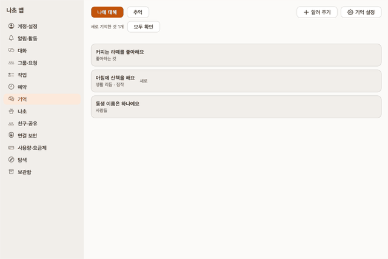
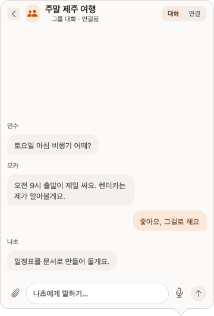
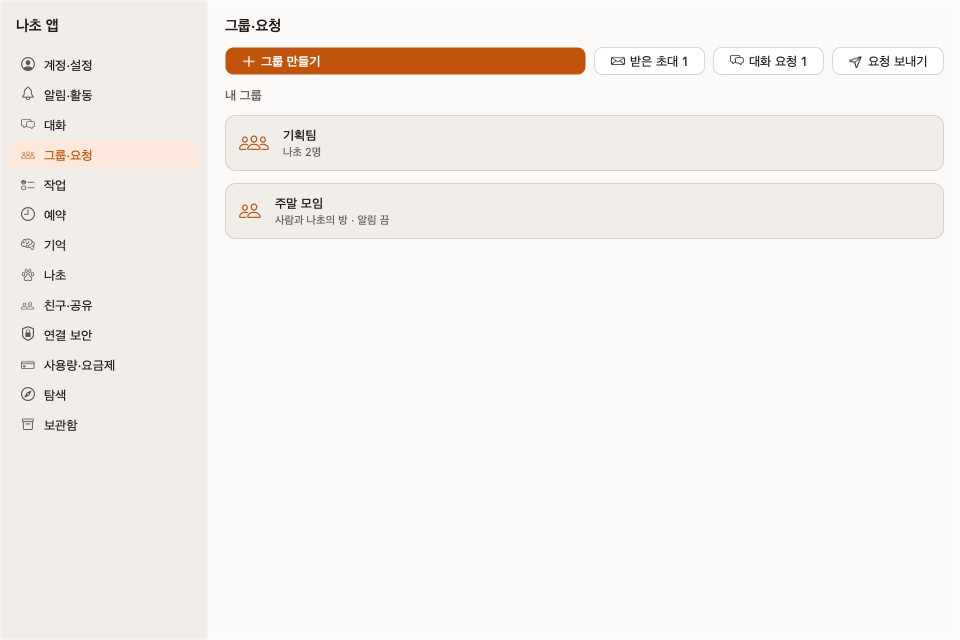
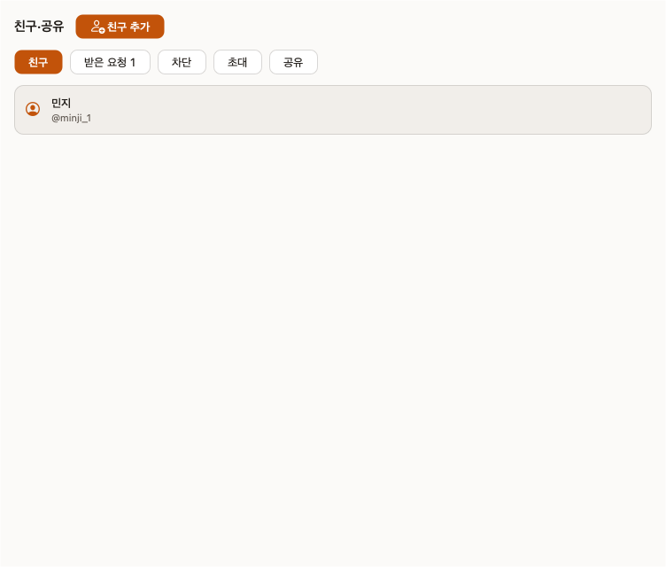
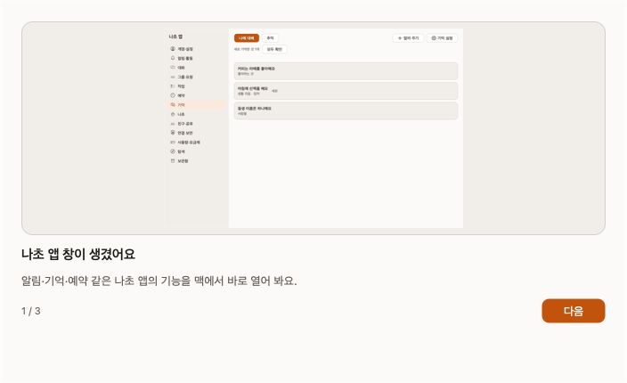

## What's new in 0.11.0

_Pictures were rendered offscreen by the macOS CI runner with made-up data (not a real Mac screen). GIFs and the What's new window screenshots come from the same renders. Names, prices and accounts in the pictures are examples. The app's screens are in Korean; button names are given in Korean with an English gloss._

### The Nacho app, now in a window on your Mac
Open the Nacho app window from Nacho Pet and use your Nacho account's sections without picking up your phone.

1. Right-click the Nacho character in the corner of the screen (or open Nacho Pet's settings).
2. Choose **나초 앱 열기…** (Open Nacho app).
3. Pick a section in the left sidebar. The steps below use these section names.

### See and edit what Nacho remembers
Read your memories, add one, fix a wrong one, or pause remembering.

1. Open **기억** (Memory) in the sidebar.
2. Tap a memory to read it, **고치기** (Edit) to fix it, or **알려 주기** (Tell Nacho) to add one.
3. Use **기억 설정** (Memory settings) to pause remembering.

### Notifications and activity in one place
See Nacho's alerts and friends' news together, and choose which ones you get.

1. Open **알림·활동** (Notifications · Activity).
2. Switch between the **알림** (Notifications) and **활동** (Activity) tabs.
3. Open the **설정** (Settings) tab to choose which alerts you get.

### Your conversations, searched and kept
Find a chat, search messages, rename a chat, and put chats you want to keep aside.

1. Open **대화** (Conversations).
2. Type a word and press **검색** (Search).
3. Open a conversation to **이름 바꾸기** (Rename) or **보관** (Keep) it; kept chats are under **보관한 대화** (Kept chats).

### Several rooms at once
Talk with Nacho in a group chat or another room from the Mac's chat window, then go back to your own chat.

1. In the Nacho app window, open **대화** (Conversations) and pick a room.
2. Tap **대화창에서 이어 말하기** (Continue in the chat window); the chat window opens that room.
3. Use the back arrow at the top of the chat window to return to your own chat. Each room keeps its own history.

### Groups and requests
See your groups, invitations and requests, create a group, and change its settings.

1. Open **그룹·요청** (Groups · Requests).
2. **수락** (Accept) or **거절** (Decline) an invitation.
3. Tap **그룹 만들기** (Create group) to start one.

### Tasks Nacho is doing
Follow a task's plan, logs and live view, and see why one failed.

1. Open **작업** (Tasks).
2. Tap a task, then **계획 보기** (Plan) or **기록 보기** (Logs).
3. Tap **원격 화면 열기** (Open live view) while it runs.

### Schedules
See what Nacho does on a schedule, read the run log, and run one now.

1. Open **예약** (Schedules).
2. Tap one to see its details and **실행 기록** (Run log).
3. **지금 한 번 실행** (Run now) asks first, because it uses credits.

### Your Nachos
See your Nachos and edit their traits and voices. Making a Nacho photo asks first, because it uses credits.

1. Open **나초** (Nacho).
2. Pick a Nacho to see its details.
3. Use **닮은 점** (Traits) or **목소리** (Voice), or **사진 만들기** (Make photo) after confirming.

### Friends and sharing
See friends and requests, invite someone, and choose what you share.

1. Open **친구·공유** (Friends · Sharing).
2. Tap **친구 추가** (Add friend), or open the **초대** (Invite) tab.
3. Use the **공유** (Sharing) tab to choose what is shared. Open a friend to block them (it asks twice).

### Connection security
See which apps and devices are connected, read the log, and set rules.

1. Open **연결 보안** (Connection security).
2. Tap a connection to see details, or read the **사용 기록** (Usage log) tab.
3. Use the **승인 규칙** (Approval rules) tab to allow or block.

### Usage and plans
See what you used, your credit ledger and the plans.

1. Open **사용량·요금제** (Usage · Plans).
2. Tap **사용 내역** (Ledger) or **요금제 보기** (Plans).
3. To buy credits, use the Nacho app on your phone.

### Explore
Browse suggestions, hand one to a Nacho, and bring back one you hid.

1. Open **탐색** (Explore).
2. Pick the Nacho in **맡을 나초** (Nacho to do it) and tap a card's button to hand it over, or **관심 없어요** (Not interested) to hide it.
3. Use **숨김 되돌리기** (Undo hide) to bring a hidden card back.

### The archive
See the documents, files and videos Nacho made or you saved, save them to the Mac, and see what Nacho can make.

1. Open **보관함** (Archive).
2. Tap an item for its details, or **저장…** (Save…) to keep a copy on the Mac.
3. Use **문서 만들기 옵션** (Document options) to copy a request you can send to Nacho in a chat.

### Join Nacho from the Mac
Finish signing up for Nacho on the Mac. You read and agree to each term, then continue. Phone number verification stays in the phone app.

1. Log in from Nacho Pet with a new account and open the Nacho app window; the sign-up steps appear there.
2. Read each term with **보기** (View) and tick the required ones.
3. Tap **계속** (Continue).

### A new Connections tab
Tools, connectors and gadgets are now three sections in one list. Switch each on or off, open details, add a service, turn off single Mac actions, and set **always allow** for a gadget.

1. Open Nacho Pet's **Connections** tab.
2. Use a switch to turn one on or off.
3. Tap a row for details, or **서비스 추가** (Add service) to connect a new one.

### The What's new window
After an update, a window shows what changed, one card at a time.

1. Update the app and open it.
2. Read the card, then go on with **다음** (Next) or back with **이전** (Previous).
3. Tap **닫기** (Close) on the last card.

## Not in this version
- **Voice calls, buying credits, and typing a login or security code on a card.** These stay in the Nacho app on your phone; the Mac only tells you to use it.

## Off by default
- **Deleting your account** and **deleting all memories** are switched off. Nothing in the window can run them.

## Uses credits
- **Run a schedule now** and **make a Nacho photo** use credits. A confirm window appears before they start.

## Known issues (low, next version)
- A `not_found` error can show the attachment message by mistake.
- Changing a memory's visibility from shared to own can show the wrong error text.

## Not yet tried on a real Mac
Everything above was checked with tests and offscreen renders in CI only (macOS runner, ad-hoc signed app). Pictures are not real screenshots. Not checked on a Mac: reopening the What's new window from the menu, the confirm sheets, macOS permission prompts (including the ones from the new Connections tab), the OAuth return to the app from the browser, a gadget staying off after a restart, and the live view's real link to Nacho Deep. Nacho's chats and the app sections were tested against fixed fake servers, not the live one.

Your settings stay as they were. The app is still ad-hoc signed, so macOS may ask for the Keychain password once.
