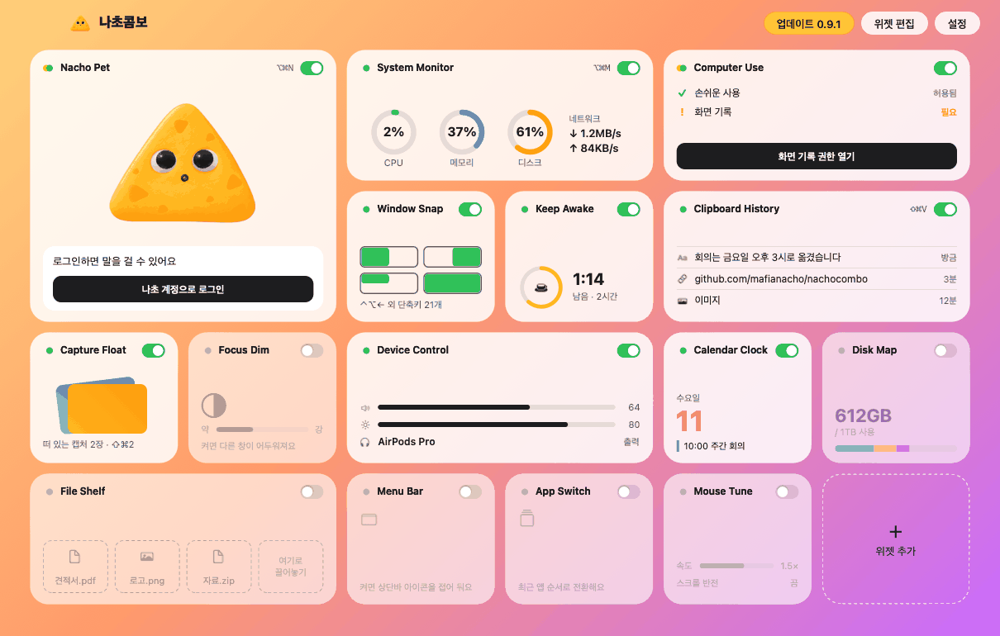
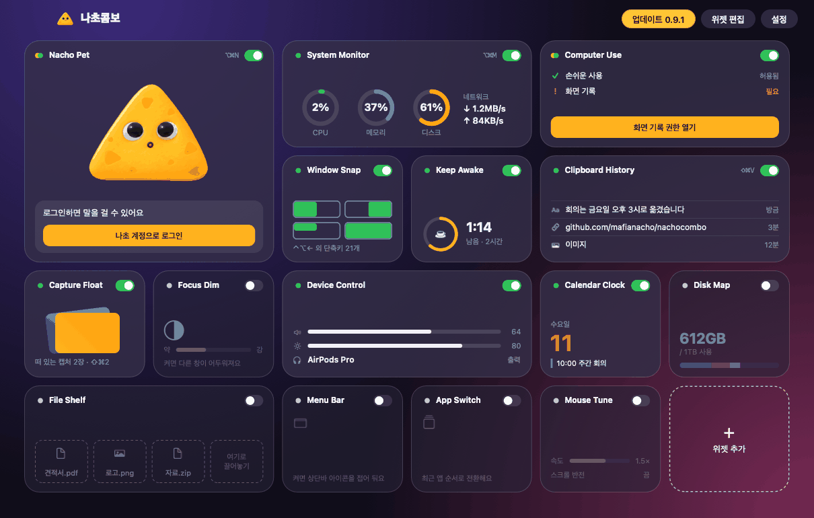
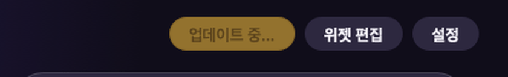

## What's new in 0.12.1

_Pictures were rendered offscreen by the macOS CI runner with made-up data (not a real Mac screen), so the window's red/yellow/green buttons are not drawn in them. They are screenshots rendered by the app, not a recording. The GIFs in the What's new window are built from the same renders. The app's screens are in Korean; button names are given in Korean with an English gloss._

### Update from the widget window
When a newer version is out, a yellow button appears at the top right of the widget window, so you no longer have to open Settings to update.

1. When a newer version exists, the yellow **업데이트 x.y.z** (Update x.y.z) button shows to the left of **위젯 편집** (Edit widgets). Click it.
2. The same question as in Settings opens on the widget window: **Restart to Update** or **Later**. The update logic itself (download, checks, swap, rollback) is unchanged.
3. While the new version downloads, the button reads **업데이트 중…** (Updating…) and is dimmed. When it is ready it reads **재시작해 업데이트** (Restart to update); click it to restart into the new version.

The button is hidden while there is nothing to update, while checking, after a failed check, and while you edit widgets (only **완료** (Done) shows then). In a very narrow window (420 pt) the text shortens to **업데이트** so nothing overlaps.

**This button first shows up for the update after this one.** 0.12.0 has no such button, so you update to 0.12.1 the usual way (the menu bar menu's **Update to 0.12.1…** item or Settings ▸ General). From 0.12.1 on, the next update appears in the widget window.

### The Nacho mascot and logo at the top left
The plain title "나초콤보" at the top left of the widget window is now the Nacho mascot with the 나초콤보 wordmark next to it.

1. Open the widget window (**전체 도구 열기 ›** (Open all tools) in the menu bar board, as before).
2. Look at the top left, next to the window buttons. In light and dark looks the wordmark follows the app colors.

While you edit widgets the logo hides, as the title did. In a very narrow window only the mascot stays. A build without the character pictures shows the text only, as before.

The wordmark is plain heavy text in the app's widget-window font, because no separate logo file is registered yet. A different logo can replace it later in one place.

## Not yet tried on a real Mac
The button states, the layout (including the 420 pt width and edit mode), light and dark, and which window the confirmation hangs on were checked with unit tests and off-screen renders in CI only. These have **not** been tried on a real Mac: the confirmation sheet opening on the real widget window, the button changing through a real update (available → downloading → ready → restart), how the mascot and the window's red/yellow/green buttons sit together in the real window, and Retina rendering.

The app is still ad-hoc signed, so macOS may ask you to allow Screen Recording and Accessibility again after an update.
