## What's new in 0.13.0

_Pictures were rendered offscreen by the macOS CI runner with made-up data (not a real Mac screen), so the window's red/yellow/green buttons are not drawn in them, and values such as the version number shown in the settings are test values. They are screenshots rendered by the app, not a recording. The GIFs in the What's new window are built from the same renders. The app's screens are in Korean; button names are given in Korean with an English gloss. The texts inside each gadget's panel are in English, as they were in the old settings window._

### Settings now live in the widget window
The separate settings window is gone. Click a widget on the wall and a panel slides in from the right of the same window, so you change a gadget's settings next to the gadget itself.

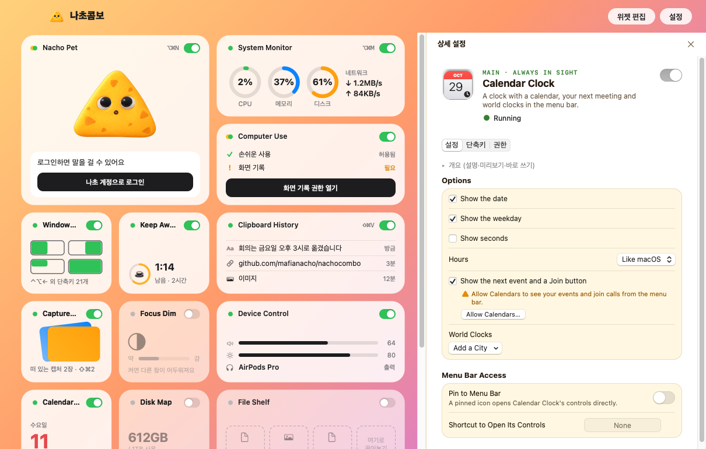

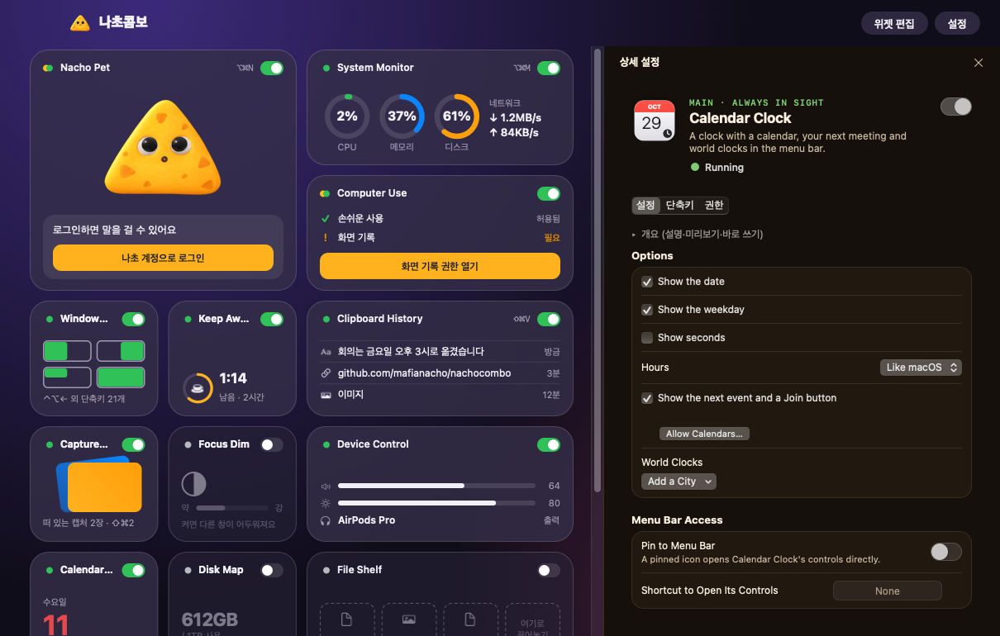

1. Click a widget (or press Return on a focused one). The panel slides in from the right (about 0.2 s; no animation if Reduce Motion is on). The wall stays visible and usable next to it.
2. Click another widget: only the panel's content changes. Close it with the ✕ button, **Esc**, or by clicking the same widget again.
3. The panel header shows the gadget's icon, name, real state (`Running`, `Off`, `Needs Accessibility`) and its switch. Below it are three tabs: **설정** (Settings), **단축키** (Shortcuts) and **권한** (Permissions).

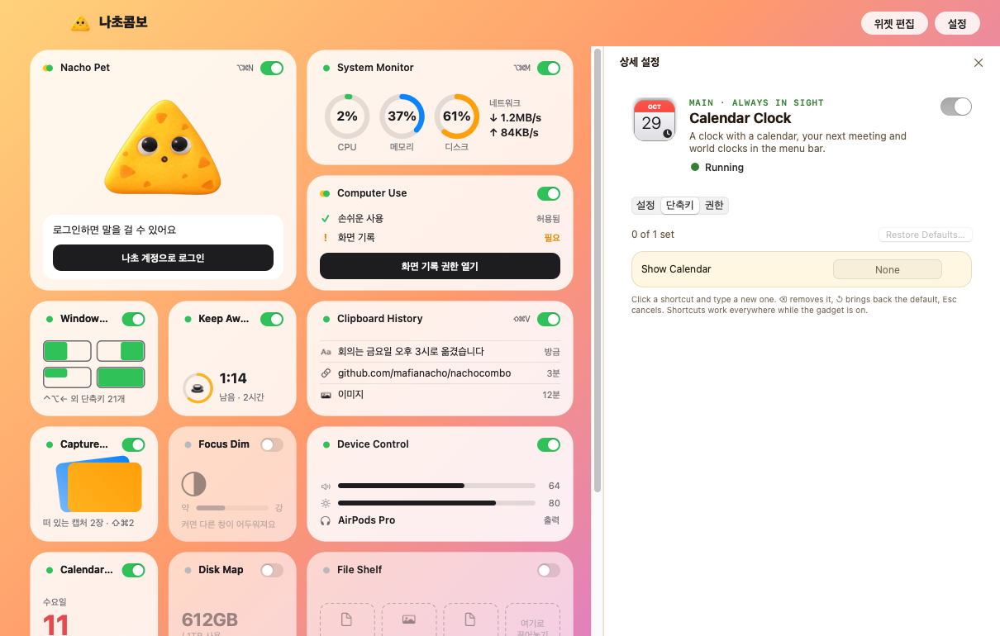

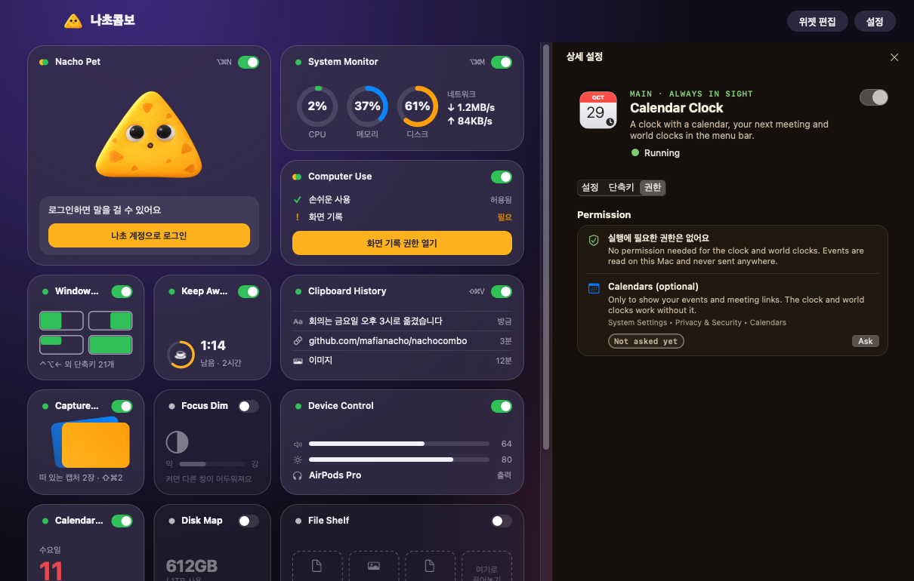

What used to be the gadget's **Overview** page is folded at the top of the **설정** tab (**개요**, open by default while the gadget is off). Nothing was added or removed: the options, shortcuts and permission steps are the old ones, moved into the panel. Your saved choices are untouched, so they are all still there after the update.

### All fifteen gadgets, in the same panel
Every gadget opens its settings the same way: Menu Bar Organizer, System Monitor, Window Snap, File Shelf, Capture Float, Focus Dim, Keep Awake, Clipboard History, Device Control, App Switch, Mouse Tune, Calendar Clock, Disk Map, Computer Use and Nacho Pet. A gadget that needs no permission says so on its **권한** tab (**필요한 권한이 없어요**).

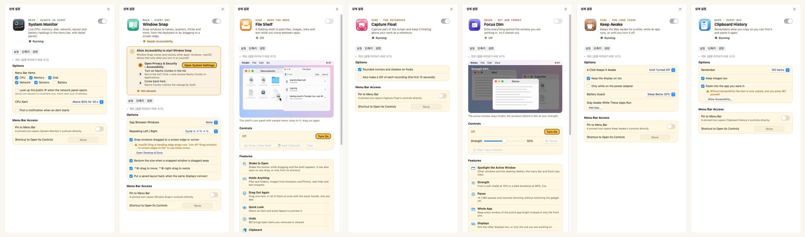

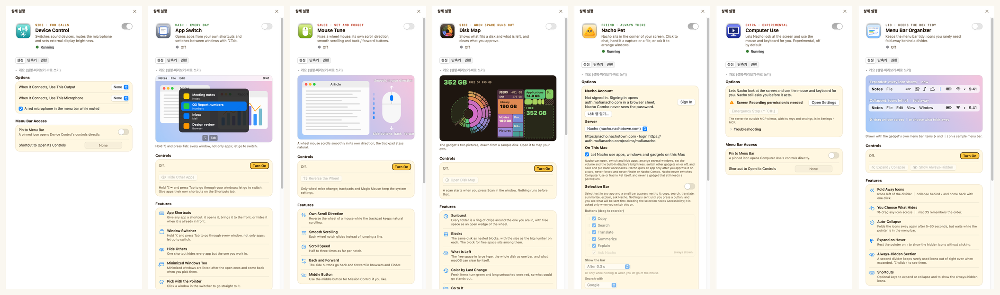

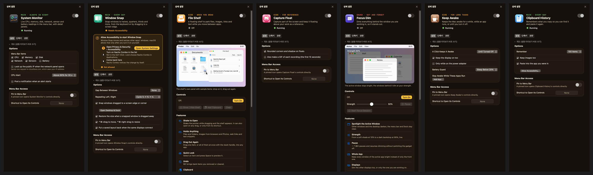

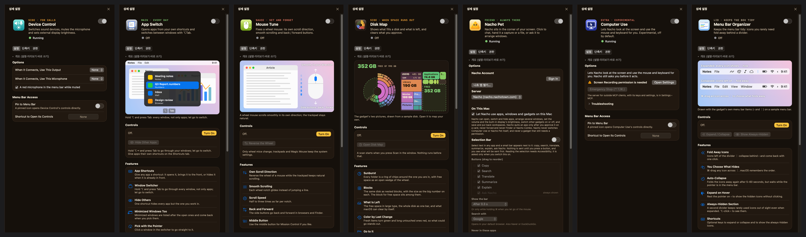

### App settings in the same panel
The **설정** (Settings) pill at the top right of the window opens the same panel on the app's own settings. Press it again to close.

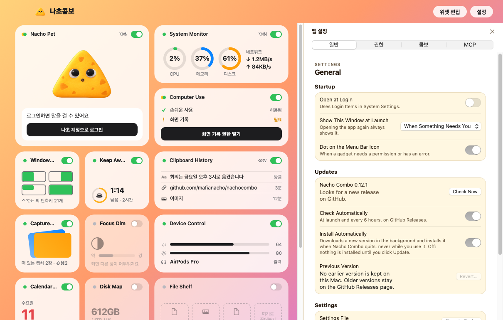

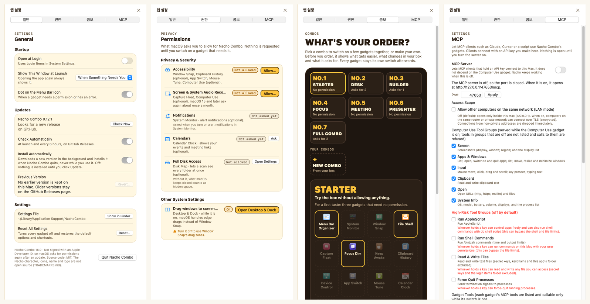

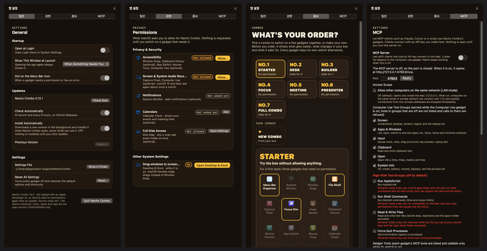

1. Click **설정**. The tabs are **일반** (General: Open at Login, Show This Window at Launch, updates, Reset All Settings, Quit), **권한** (Permissions), **콤보** (Combos) and **MCP**.
2. The old "All Gadgets" page is gone: the widget wall is the gadget list now.
3. Everything that used to open the settings window now brings the widget window to the front and opens the right page of the panel: **Settings…** in the menu bar icon's menu, a gadget's own **Settings…**, the combo menu on the first launch, and the notices that ask you to allow a permission.

### Edit mode and hidden widgets
**위젯 편집** (Edit widgets) closes the panel and opens the edit drawer (size, pin, shortcut), as before. The panel and the drawer never show together, and no panel opens while you edit.

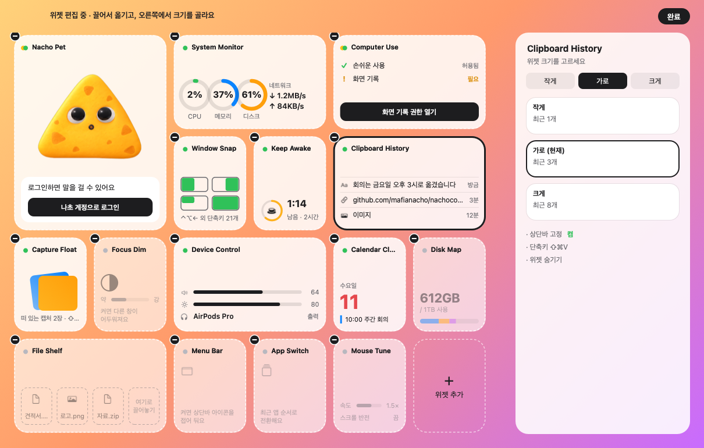

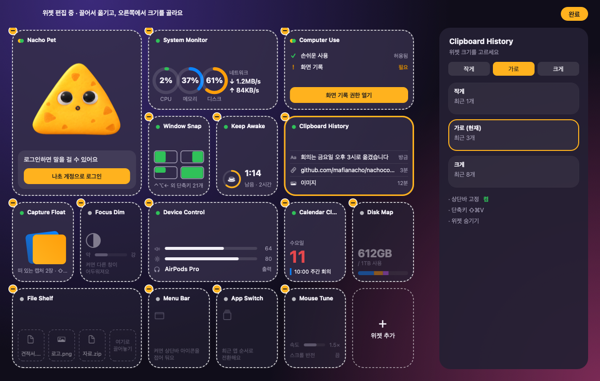

A widget you hid from the wall is still one click away: the **＋** card lists hidden widgets, each with **다시 보이기** (Show again) and **설정 열기** (Open settings), which opens its panel without putting it back on the wall.

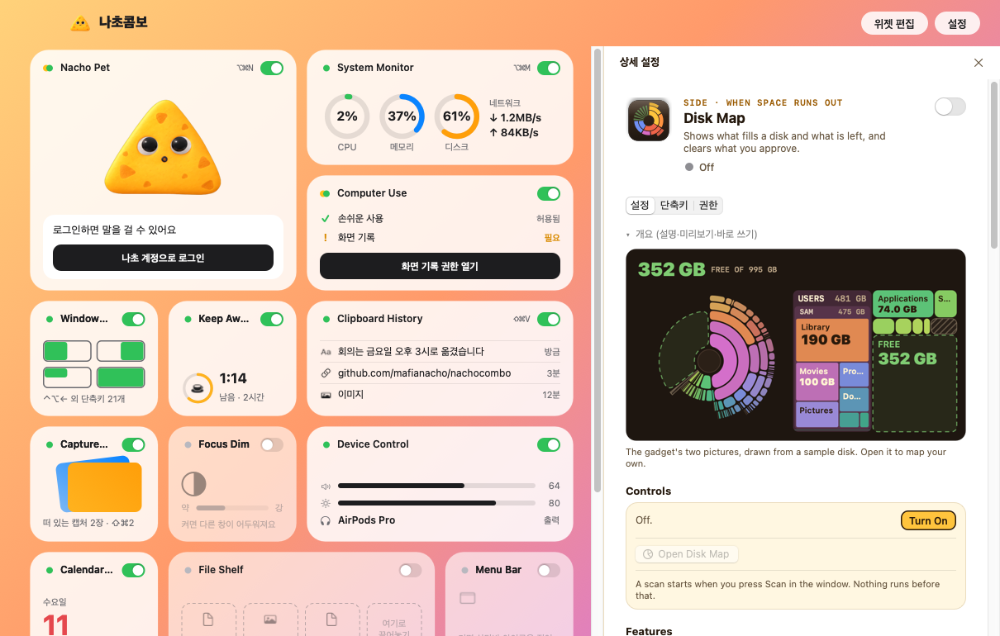

### The window is a little wider at its narrowest
**The smallest the widget window can be is now 480 pt wide (it was 420 pt).** That is the panel's own width, so every control of the panel always shows without a sideways scroll. If your saved window was narrower than that, it grows to 480 pt once. Below about 840 pt wide the panel covers the wall instead of sitting beside it; close it to get the wall back.

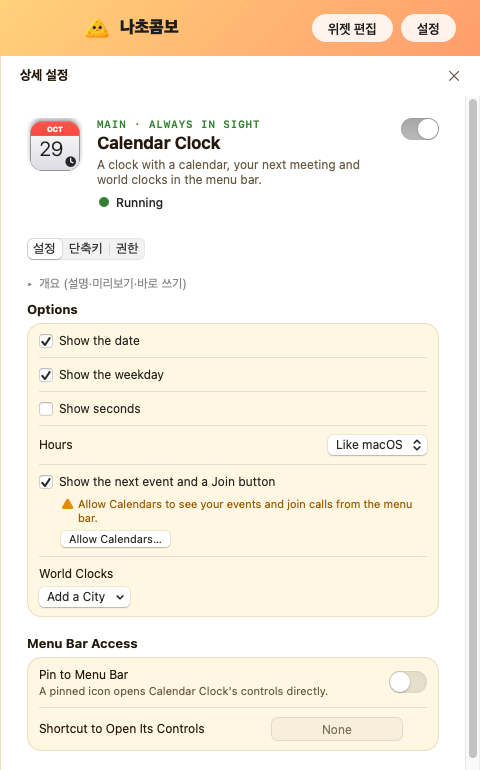

## Not yet tried on a real Mac
The panel, its tabs, the switch between gadgets, the entry points, edit mode and the narrowest width were checked with unit tests and off-screen renders in CI only (the test run had 1395 tests and no failures). These have **not** been tried on a real Mac: the real slide-in motion, how the panel sits next to the real window buttons, a real app restart to see that a changed setting stays, the permission dialogs of macOS opened from the panel, Retina rendering, and the stability of the live numbers while the panel is open.

A few things to know: when the panel is open next to the wall, long widget names are cut short with an ellipsis, and the open widget is not highlighted yet. A permission note on a gadget's **권한** tab may break its line before the **▸** arrow.

The app is still ad-hoc signed, so macOS may ask you to allow Screen Recording and Accessibility again after an update.
